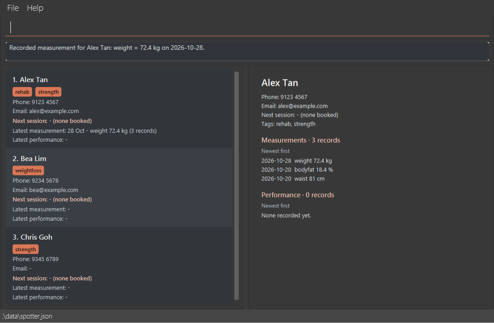
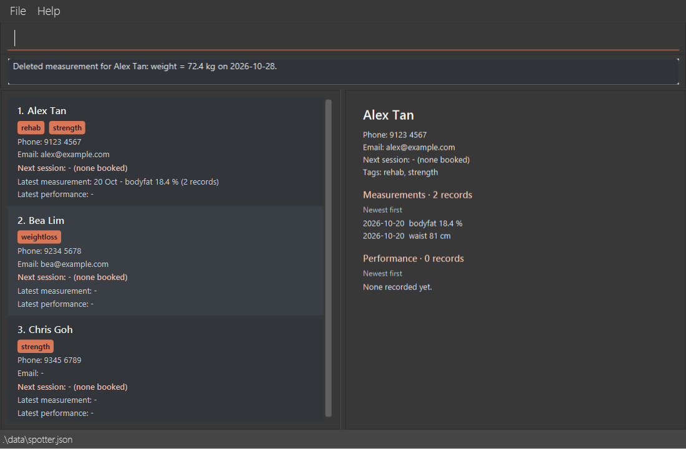
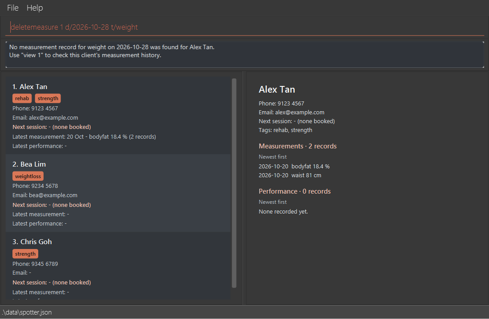

# Spotter Developer Guide

<!-- * Table of Contents -->
<page-nav-print />

--------------------------------------------------------------------------------------------------------------------

## **Acknowledgements**

* Spotter is based on [AddressBook-Level3](https://se-education.org/addressbook-level3/) (AB3), the sample project
  of the [SE-EDU initiative](https://se-education.org).
* Spotter uses [JavaFX](https://openjfx.io/) for its GUI, [Jackson](https://github.com/FasterXML/jackson) to read
  and write its JSON data file, and [JUnit 5](https://junit.org/junit5/) for its tests.

* OpenAI Codex and Claude Code assisted the team with implementation, testing, documentation and PR reviews
  across most Spotter features.
* The GUI tests use [TestFX](https://github.com/TestFX/TestFX) to run JavaFX UI parts in tests.

--------------------------------------------------------------------------------------------------------------------

## **Setting up, getting started**

Refer to the guide [_Setting up and getting started_](SettingUp.md).

--------------------------------------------------------------------------------------------------------------------

## **Design**

### Architecture

<puml src="diagrams/ArchitectureDiagram.puml" width="280" />

The ***Architecture Diagram*** given above explains the high-level design of the App.

The following provides a quick overview of the main components and their interactions.

**Main components of the architecture**

**`Main`** (consisting of classes [`Main`](https://github.com/AY2627S1-CS2103T-F14a-2/tp/blob/master/src/main/java/seedu/address/Main.java) and [`MainApp`](https://github.com/AY2627S1-CS2103T-F14a-2/tp/blob/master/src/main/java/seedu/address/MainApp.java)) is in charge of the app launch and shut down.
* At app launch, it initializes the other components in the correct sequence, and connects them up with each other.
* At shut down, it shuts down the other components and invokes cleanup methods where necessary.

The bulk of the app's work is done by the following four components:

* [**`UI`**](#ui-component): The UI of the App.
* [**`Logic`**](#logic-component): The command executor.
* [**`Model`**](#model-component): Holds the data of the App in memory.
* [**`Storage`**](#storage-component): Reads data from, and writes data to, the hard disk.

[**`Commons`**](#common-classes) represents a collection of classes used by multiple other components.

**How the architecture components interact with each other**

The *Sequence Diagram* below shows how the components interact with each other for the scenario where the user issues the command `delete 1`.

<puml src="diagrams/ArchitectureSequenceDiagram.puml" width="574" />

Each of the four main components (also shown in the diagram above),

* defines its *API* in an `interface` with the same name as the Component.
* provides its functionality through a concrete `{Component Name}Manager` class that implements the corresponding API interface.

For example, the `Logic` component defines its API in `Logic.java` and implements it in `LogicManager.java`. Other components interact with a component through its interface rather than its concrete class, preventing them from coupling to that component's implementation, as illustrated in the following partial class diagram.

<puml src="diagrams/ComponentManagers.puml" width="300" />

The sections below give more details of each component.

### UI component

The **API** of this component is specified in [`Ui.java`](https://github.com/AY2627S1-CS2103T-F14a-2/tp/blob/master/src/main/java/seedu/address/ui/Ui.java)

<puml src="diagrams/UiClassDiagram.puml" alt="Structure of the UI Component"/>

The UI consists of a `MainWindow` and its parts, such as `CommandBox`, `ResultDisplay`, `PersonListPanel`, `UpcomingSessionPanel`, `ClientDetailPanel`, and `StatusBarFooter`. All of these, including `MainWindow`, inherit from the abstract `UiPart` class, which captures common behavior among classes that represent visible GUI parts.

The `UI` component uses the JavaFX UI framework. The layouts of these UI parts are defined in matching `.fxml` files in `src/main/resources/view`. For example, [`MainWindow.fxml`](https://github.com/AY2627S1-CS2103T-F14a-2/tp/blob/master/src/main/resources/view/MainWindow.fxml) specifies the layout of [`MainWindow`](https://github.com/AY2627S1-CS2103T-F14a-2/tp/blob/master/src/main/java/seedu/address/ui/MainWindow.java).

The `UI` component,

* executes user commands using the `Logic` component.
* listens for changes to `Model` data so that the UI can be updated with the modified data.
* keeps a reference to the `Logic` component, because the `UI` relies on the `Logic` to execute commands.
* depends on some classes in the `Model` component because it displays `Person` objects from the model.

`ResultDisplay` measures its wrapped text with a JavaFX `Text` using the feedback area's font and available width.
Its preferred height ranges from 44 to 112 logical pixels, freeing space for the lists after short confirmations.
Longer messages remain complete in a wrapping, selectable, read-only `TextArea` with scrolling. Resizing the
window recalculates the height. The surrounding placeholder has no fixed height.

Card typography, selection borders and tag contrast are defined in `DarkTheme.css`. Both card layouts use the
same padding and line spacing. Names, email addresses and record summaries wrap within the card width.

### Logic component

**API** : [`Logic.java`](https://github.com/AY2627S1-CS2103T-F14a-2/tp/blob/master/src/main/java/seedu/address/logic/Logic.java)

Here's a (partial) class diagram of the `Logic` component:

<puml src="diagrams/LogicClassDiagram.puml" width="550"/>

The sequence diagram below illustrates the interactions within the `Logic` component, taking `execute("delete 1")` API call as an example.

<puml src="diagrams/DeleteSequenceDiagram.puml" alt="Interactions Inside the Logic Component for the `delete 1` Command" />

<box type="info" seamless>

**Note:** The lifeline for `DeleteCommandParser` should end at the destroy marker (X), but due to a limitation of PlantUML, the lifeline continues till the end of diagram.
</box>

How the `Logic` component works:

1. When `Logic` is called upon to execute a command, the command is passed to an `AddressBookParser` object, which in turn creates a parser that matches the command (e.g., `DeleteCommandParser`) and uses it to parse the command.
1. This results in a `Command` object (more precisely, an object of one of its subclasses e.g., `DeleteCommand`) which is executed by the `LogicManager`.
1. The command can communicate with the `Model` when it is executed (e.g. to delete a client). 
   Note that although this is shown as a single step in the diagram above for simplicity, the code can require several interactions between the command object and the `Model` to complete the operation.
1. The result of the command execution is encapsulated as a `CommandResult` object which is returned from `Logic`.

Here are the other classes in `Logic` (omitted from the class diagram above) that are used for parsing a user command:

<puml src="diagrams/ParserClasses.puml" width="600"/>

How the parsing works:
* When called upon to parse a user command, the `AddressBookParser` class creates an `XYZCommandParser` (`XYZ` is a placeholder for the specific command name, e.g., `AddCommandParser`). The parser uses the other classes shown above to parse the user command and create an `XYZCommand` object (e.g., `AddCommand`). The `AddressBookParser` returns that object as a `Command` object.
* All `XYZCommandParser` classes, such as `AddCommandParser` and `DeleteCommandParser`, implement the `Parser` interface so they can be treated similarly where appropriate, for example during testing.

### Model component
**API** : [`Model.java`](https://github.com/AY2627S1-CS2103T-F14a-2/tp/blob/master/src/main/java/seedu/address/model/Model.java)

<puml src="diagrams/ModelClassDiagram.puml" width="900" alt="Spotter Model component and client training records" />

Each `Person` holds contact details, tags, an optional `NextSession`, an immutable list of `Measurement`
records and a `PerformanceHistory`. Each measurement has a `MeasurementType`; the performance history
holds `GymPerformance` records with an `ExerciseName` and `Load`. Email is optional, and a client may have
no session or progress records. The diagram shows the current model; there is no postal-address field.

The `Model` component,

* stores all Spotter client data, i.e., all `Person` objects (which are contained in a `UniquePersonList` object).
* stores the `Person` objects selected by the current filter, such as search results, in a separate _filtered_ list. It exposes this list as an unmodifiable `ObservableList<Person>` that the UI can observe and bind to, so the UI updates when the list changes.
* stores the clients with an upcoming session, soonest first, in a separate list built from all clients (so `find` and `filter` do not affect it). It is exposed as an unmodifiable `ObservableList<Person>` for the UI's Upcoming sessions panel.
* stores the client shown by `view` (or none) and exposes it as an `ObservableValue<Person>`, so that the UI's detail panel can follow that client.
* stores a `UserPrefs` object that represents the user’s preferences (currently, just the GUI settings). This is exposed to the outside as a `ReadOnlyUserPrefs` object.
* does not depend on any of the other three components (as the `Model` represents data entities of the domain, they should make sense on their own without depending on other components)

### Storage component

**API** : [`Storage.java`](https://github.com/AY2627S1-CS2103T-F14a-2/tp/blob/master/src/main/java/seedu/address/storage/Storage.java)

<puml src="diagrams/StorageClassDiagram.puml" width="800" alt="Spotter JSON storage and progress-record adapters" />

`JsonAdaptedPerson` stores tags, measurements and gym performances as collections of `JsonAdaptedTag`,
`JsonAdaptedMeasurement` and `JsonAdaptedGymPerformance` respectively. The optional next session is
stored directly as a `String`, rather than through a separate adapter. On loading, these values are
validated and converted into the corresponding client fields and records; older files without progress
collections load with empty histories.

The `Storage` component,
* can save both client data and user preference data in JSON format, and read them back into corresponding objects.
* is implemented by `StorageManager`, which delegates the actual JSON file access to `JsonAddressBookStorage` and `JsonUserPrefsStorage` (one class per data file).
* depends on some classes in the `Model` component (because the `Storage` component's job is to save/retrieve objects that belong to the `Model`)

### Common classes

Classes used by multiple components are in the `seedu.address.commons` package.

--------------------------------------------------------------------------------------------------------------------

## **Implementation**

This section describes some noteworthy details on how certain features are implemented.

### Application file locations

`AppPaths` resolves the home folder from its class's `CodeSource`: a packaged application uses the archive's
containing folder, while exploded classes used by IntelliJ or Gradle use the configured working directory.
Converting the code-location URL through a URI preserves folder names containing spaces, Unicode and percent signs.
An unknown or non-local code location fails explicitly, preventing writes to an unintended fallback folder.

`MainApp` passes absolute paths for `preferences.json` and `data/spotter.json` to the existing storage classes.
`LogsCenter` uses the same home folder during static initialization, before `MainApp#init` runs. Its
`FileHandler` pattern escapes literal percent signs so folder names cannot be interpreted as logging tokens.
If the log file cannot be opened, the already-installed console handler reports the error and remains usable.
Client-data save failures retain the existing rollback behaviour.

The path tests package the real resolver and logger into a small executable JAR and launch it in separate JVMs
from unrelated folders. This verifies archive detection, special-character paths, existing-data preservation,
relaunch behaviour and a blocked log file without changing the test JVM's working directory.

### Client name and phone formats

`Name` and `Phone` own validation and normalization so command input and JSON loading use the same rules.
`ParserUtil` reports length-specific errors before constructing the value objects. Names are trainer-facing labels,
not verified legal identities: the current scope accepts Latin-script letters (including accents), digits `0–9`
and the punctuation listed in the User Guide, rather than claiming support for every language.

`Name.normalize` first normalizes whitespace, then applies Unicode NFC. This gives composed and decomposed versions
of the same accented name one stored representation and one length check. Name identity and full-name lookup ignore
case and extra whitespace after normalization, and `find` normalizes its keywords the same way. Accents remain significant:
`José Tan` and `Jose Tan` are different names. The 100-character limit uses Java string length after normalization,
not a count of visually rendered glyphs. No transliteration or compatibility folding is performed.

`Phone` requires at least three digits and permits English-letter labels and common punctuation within a
50-character normalized value. Plain digits separated by spaces remain stored as digits only for compatibility
with older files. Other accepted formatting is retained. This is a contact field, not a dialability validator.
`getDigits` exposes the entire digit sequence; it does not infer country codes, extensions or individual numbers.

**Trade-offs:** supporting common name formats avoids unnecessary rejection without redesigning command syntax.
A space followed by a recognized prefix still starts a new field, and session commands reject slash-containing
name identifiers. Those clients remain accessible through displayed indexes. Broader script support and literal
prefix escaping require consistent parser, identity, search and storage rules, so they are deferred rather than
partially implemented here. These limits do not establish that every user's naming needs are met.

### Duplicate detection

Spotter identifies a client by name, not by phone or email. `Person#isSamePerson` delegates to
`Name#isSameName`, which compares names after Unicode NFC normalization, ignoring letter case and collapsing
repeated whitespace, so `john tan` and `John  Tan` are the same client. `UniquePersonList#contains` uses
`isSamePerson`, and `add` reaches it through `Model#hasPerson`; `edit` performs the same check only when the
edited name differs from the original.

Duplicate detection is therefore name-only: two clients cannot share a name, even when their phone numbers and
emails differ. Because phone numbers are not unique in the real world, `add` and `edit` instead append a
**non-blocking warning** (`SharedPhoneWarning`) when another client has the same complete phone digit sequence
(`Phone#getDigits`). The saved client is excluded from this comparison, so editing a client without changing
their phone never warns about themselves.

The two checks are deliberately separate: a name clash blocks the command, because `session n/NAME` and
`cancelsession n/NAME` find a client by name, while a shared phone only warns, leaving the trainer to decide
whether the entry is a genuine duplicate. Warning instead of blocking when two clients share a name is left as
future work.

<puml src="diagrams/DuplicateDetectionClassDiagram.puml" width="520" />

### Upcoming sessions panel

The right side of the window shows the clients with an upcoming session, soonest first, so that a trainer can
see who is next and prepare. It adds no new session logic. Instead, it reuses what the client list already has:

* `ModelManager` keeps a `SortedList` over a `FilteredList` of all clients. The filter keeps clients
  whose `NextSession` is not before "now", which is the same rule that the client card uses to show
  `- (none upcoming)`. The sort is the existing `PersonSessionComparator`, so the panel and the client list
  order sessions in the same way.
* Each `UpcomingSessionCard` shows the session time from `NextSession#toDisplayString`, the phone from
  `PhoneDisplayFormatter`, and the latest records from the static `PersonCard` formatters.
  The cards have no index numbers, so that they cannot be mistaken for the client list's indices.
* Booking, cancelling or recording a session replaces the client through `Model#setPerson`. The `FilteredList`
  re-tests the replaced client, so the panel updates without any command knowing about it.
  Only the passing of time changes nothing in the data, so after each successful command `LogicManager#execute`
  calls `Model#updateSessionLists(now)`. Against that one time, it re-sorts the client list (which makes
  `PersonListPanel` redraw the client cards) and drops passed sessions from this panel, so both sides agree.
  It runs only after the command, as re-sorting first could change which client a typed index refers to.

**Aspect: when to drop a passed session**

* **Alternative 1 (current choice):** On the next successful command.
  * Pros: Needs no timer, and the model logic is tested with a fixed "now".
  * Cons: A passed session stays visible until the trainer's next successful command.
* **Alternative 2:** On a timer.
  * Pros: Always exact.
  * Cons: Adds a background thread to the UI for little benefit, as the trainer types commands throughout the day.

`MainWindow` shows either this panel or the `ClientDetailPanel` in the same place, by binding each panel's
visibility to whether `Logic#getViewedPerson()` holds a client (see [View client history](#view-client-history)).

### Listing and filtering clients

`list` shows every client, and `filter t/TAG [t/MORE_TAGS]...` shows only clients with at least one of the given
tags. Neither changes client data, so `LogicManager` does not save after them.

**The displayed list.** `ModelManager` shows clients through a `SortedList` (ordered by `PersonSessionComparator`)
over a `FilteredList` of all clients. Both commands only replace the filter's predicate through
`Model#updateFilteredPersonList(Predicate)`, which also re-sorts the list. `list` uses `PREDICATE_SHOW_ALL_PERSONS`
and also stops viewing a client, so the Upcoming sessions panel shows again. The Upcoming sessions panel is built
from all clients, so a filter never hides a booking there.

**Parsing.** `AddressBookParser` rejects any text after `list` with `ListCommand.MESSAGE_EXTRA_PARAMETERS`.
`FilterCommandParser` requires at least one `t/` and no text before it, rejects an empty tag, and rejects a tag that
`Tag#isValidTagName` would not accept, since such a tag could never match a stored client. Each error is shown with
the `filter` usage. It trims each tag, drops a tag that repeats an earlier one ignoring case (keeping the first
spelling), and creates a `TagContainsKeywordsPredicate`.

<puml src="diagrams/FilterSequenceDiagram.puml" alt="Interactions Inside the Logic and Model Components for the `filter t/rehab` Command" />

**Matching.** `TagContainsKeywordsPredicate` matches a client if any of their tags equals any keyword, ignoring case.
It compares whole tag names, so `REHAB` matches `rehab` but `reh` does not, and several tags give an `OR` search.

**Result messages.** Each command chooses its message from the number of displayed clients.
`ListCommand#getResultMessage` uses `Messages#getClientsListedMessage` (shared with `find`): `Listed N clients.` or
`Listed 1 client.`, or `You have no clients yet. Use "add" to add your first client.` when there are no clients.
`FilterCommand#getResultMessage` names the tags as typed, joined as `rehab`, `rehab or knee` or
`rehab, knee or strength`: `Listed N clients tagged TAGS.`, `Listed 1 client tagged TAGS.`, or, for an empty result,
`No clients tagged TAGS. Use "list" to show all clients.` Counts are formatted with `Locale.ROOT`, so they use ASCII
digits on every system.

**Scrolling and indices.** `list` and `filter` both return a `CommandResult` with `scrollToTop` set, and `MainWindow`
then scrolls the client list to the first client. Index-based commands resolve `INDEX` against `Model#getFilteredPersonList()`, so an
index refers to a position in the list as currently displayed. After `list` or `filter`, the same client can have a
different index, which is why the User Guide asks trainers to check the list before an index-based command.

**Aspect: how `filter` interacts with the current list**

* **Alternative 1 (current choice):** `filter` replaces any previous `find`, `filter` or `sessions` predicate.
  * Pros: Only one filter is ever active, so the displayed list is easy to predict, and `list` always resets it.
    Every command resolves indices against the same displayed list.
  * Cons: Filters cannot be combined, e.g. clients named Alex who also have the `rehab` tag.
* **Alternative 2:** `filter` narrows the current list, combining its predicate with the previous one.
  * Pros: Lets a trainer narrow a long list step by step.
  * Cons: The active filter becomes hidden state that the trainer must remember, a `filter` with no results may be
    caused by an earlier command, and every filtering command would need a way to clear only part of the filter.

### View client history

`view INDEX` shows one client's details followed by their full measurement and gym-performance history in the
`ClientDetailPanel`, in place of the Upcoming sessions panel. It follows the usual `Logic` flow: `ViewCommandParser`
parses the index, and `ViewCommand` looks the client up in `Model#getFilteredPersonList()` and passes it to
`Model#setViewedPerson(Person)`. The `CommandResult` only carries a one-line confirmation for the result display.

<puml src="diagrams/ViewSequenceDiagram.puml" alt="Interactions Inside the Logic Component for the `view 1` Command" />

`view` is read-only. As `LogicManager` only saves when a command changes client data, executing `view`
never writes the data file.

**Keeping the panel up to date.** `ModelManager` holds the viewed client in an `ObservableValue<Person>`, which
`Logic#getViewedPerson()` exposes to the UI. `ClientDetailPanel` listens to it and redraws whenever it changes.
As `Person` is immutable, a command that changes a client, e.g. `edit` or `measure`, replaces it through
`Model#setPerson(target, editedPerson)`. If `target` is the viewed client, `ModelManager` views `editedPerson`
instead, so the panel follows the client without any command knowing about the panel:

<puml src="diagrams/ViewedClientSyncSequenceDiagram.puml" alt="How the detail panel follows the viewed client after `measure`" />

In the same way, `Model#deletePerson` and `Model#setAddressBook` (used by `clear`) stop viewing a client that
no longer exists, and `ListCommand` stops viewing any client. The Upcoming sessions panel then shows again.
If saving fails, `LogicManager` restores the viewed client together with the client data and the filter, so
the panel matches the restored data.

Design notes:

* **Non-UI formatter:** `ClientHistoryFormatter` is a plain class in `logic.commands` with no JavaFX dependency,
  so the panel's text can be checked in unit tests without starting the GUI. Its detail and record formatting
  methods supply separate labels in `ClientDetailPanel`. Measurements and performance have styled headings with
  counts and a newest-first hint, and the client card uses the same placeholders for a missing email or session.
* **"Now" at drawing time:** whether the next session has passed is decided when the panel is drawn, as on the
  client card. `MainWindow` also redraws the panel after every successful command, so a session that passes
  while the panel is open is shown the same way as on the card.
* **Scroll position:** when the viewed client changes to a different client (by `Person#isSamePerson`), the
  panel scrolls back to the top. A replacement of the same client, e.g. a new record, keeps the scroll position.
* **Ordering:** both histories are listed newest first. Measurements on the same date follow the type order
  weight, body fat, waist. Performance records on the same date are listed most recently recorded first, so the
  first line always matches the client card's "Latest performance".

**Aspect: where to show the history**

* **Alternative 1:** Show it as text in the result display (used up to v1.4).
  * Pros: Needs no UI changes, and the output is easy to test.
  * Cons: The result display is only a few lines tall, the history is replaced by the next command's result,
    and it goes stale when the client's records change.
* **Alternative 2 (current choice):** Show it on the right side of the window, in place of Upcoming sessions.
  * Pros: Has room for a long history, stays visible while records are logged during a session, and updates as
    the client changes.
  * Cons: Hides Upcoming sessions until `list`, and the viewed client must be kept in sync in the model.

**Aspect: where to keep the viewed client**

* **Alternative 1 (current choice):** In `ModelManager`, updated by `setPerson`, `deletePerson` and `setAddressBook`.
  * Pros: The model is the only place that knows which new `Person` replaces which old one, and the sync logic
    can be unit tested without JavaFX.
  * Cons: Adds UI-related state to the model.
* **Alternative 2:** In the UI, which would search the client list for the viewed client after every command.
  * Pros: Leaves the model unchanged.
  * Cons: An edited client cannot be matched reliably, e.g. after its name changes, and the logic would be in
    GUI code that is hard to test.

### Recording and deleting gym performances

`performance INDEX d/DATE e/EXERCISE s/SETS r/REPS w/LOAD` records one result for the client at the displayed index,
and `deleteperformance INDEX d/DATE e/EXERCISE` removes one. Both follow the usual `Logic` flow: the parser validates
the fields, and the command resolves the index against `Model#getFilteredPersonList()`.

Both parsers first check the command's shape: no prefix the command does not use
(`ParserUtil#rejectUnsupportedPrefixes`, as the session and measurement commands do), and an integer index followed by each prefix
exactly once (`ArgumentMultimap#hasEachPrefixOnce`). Without the first check, AB3's tokenizer would read an unknown
prefix such as ` t/x` as part of the previous value and report that value as invalid. A shape error gives the invalid-format message. Otherwise the values are parsed
in command order, so only the first invalid value is reported, followed by the expected format. Sets and repetitions
share one counting rule, and the parser and `JsonAdaptedGymPerformance` both reuse the `GymPerformance` and `Load`
checks, so commands and the data file accept the same values, except that the parser first trims surrounding spaces.
The other difference is the date: `performance` uses `ParserUtil#parseRecordDate`, which rejects future dates, while `deleteperformance` and
storage accept them so that a future-dated record in an edited data file can still be loaded and deleted.

The following partial diagram shows how the records are stored and which classes change them. Contact fields and the
other progress data are omitted.

<puml src="diagrams/PerformanceModelClassDiagram.puml" alt="Classes used to store and change a client's gym-performance records" />

Each `Person` owns one immutable `PerformanceHistory`, which keeps the records in the order they were recorded and
never holds two records for the same exercise on the same date. Exercise names are compared through
`ExerciseName#equals`, which ignores letter case, repeated spaces and the difference between straight (`'`) and curly
(`’`) apostrophes, so a name pasted from formatted text does not split a client's history. Names may also contain
`&`, `+` and `.` (e.g. `Clean & Jerk`), but not `/`, which would let text such as ` w/` inside a name be tokenized as
another prefix. `PerformanceCommand` calls
`Person#withGymPerformance`, which replaces any record for the same exercise and date. `DeletePerformanceCommand`
finds the record through `PerformanceHistory#find` and calls `Person#withoutGymPerformance`; a missing record raises a
`CommandException` before any state changes. Either way, the command replaces the client through `Model#setPerson`,
and `LogicManager` saves the client data.

The sequence diagram below shows a successful `deleteperformance` command. Saving, and restoring the previous state
if saving fails, is the same as for `deletemeasure`.

<puml src="diagrams/DeletePerformanceSequenceDiagram.puml" alt="Interactions for the `deleteperformance 1 d/2026-09-18 e/Bench Press` command" />

Both commands log rejected indices, missing records and successful changes at `INFO` level. The log records the
displayed index, exercise and date, but not the client's name or contact details.

**Design choice:** The client card's latest performance and record count are derived from `PerformanceHistory`
rather than stored separately, so they cannot become stale after a replacement or deletion. Keeping the recording
order means the record entered last is treated as the latest when several share a date.

### Recording body measurements

`MeasurementLiveHistoryTest` executes commands with a real `LogicManager`, `ModelManager`, history panel
and client list. It checks replacement, deletion of the latest and final records, and visible rollback
after failed saves without reopening `view`. It also checks that the saved data agrees with the final state.

`measure INDEX d/DATE t/TYPE v/VALUE` records weight, body-fat percentage or waist circumference.
`MeasureCommandParser` validates the displayed index, real non-future date, type and decimal value.
Like `DeleteMeasureCommandParser`, it first rejects prefixes the command does not use
(`ParserUtil#rejectUnsupportedPrefixes`), so a stray prefix gives the invalid-format message.
`Measurement` enforces the type's range and at most two decimal places using `BigDecimal`.
Future-date validation stays in the parser so saved records remain loadable after a clock change.

`MeasureCommand` resolves the client through the displayed list and checks whether the date/type pair
already exists. `Person#withMeasurement` returns a new client with that pair replaced, or a new record
appended, preserving the client's other data. `Model#setPerson` refreshes the card and any open history
panel. Counts and the latest measurement are derived from the records rather than stored separately.
The command reports `Recorded` or `Updated`; `LogicManager` saves the result, restoring the previous
records, filter and viewed client if saving fails.

**UI example:** With Alex Tan open using `view 1`, enter
`measure 1 d/2026-10-28 t/weight v/72.4`. The feedback confirms the new record, the card shows three
measurements, and the open history shows weight, body fat and waist with their dates and units.
The two earlier records in this fictional dataset were entered on 20 October 2026.

Supported types are `weight` (1–500 kg), `bodyfat` (greater than 0 and at most 100%) and
`waist` (1–300 cm). No other measurement types are currently supported. Values accept at most two
decimal places. Entering the same date/type corrects the value rather than adding another record.

<puml src="diagrams/MeasureSequenceDiagram.puml" alt="Recording or replacing a body measurement" />

The immutable copy keeps a failed change recoverable without a separate measurement cache. The same
date/type pair identifies a record regardless of its value, so correcting a value does not increase the count.

### Measurement replacement feedback

Before updating the client, `MeasureCommand` calls `Person#findMeasurement` to find the existing measurement
with the same date and type. `Person#hasMeasurement` delegates to the same lookup.
It retains that immutable record to format the old value → new value after `Model#setPerson` succeeds.
Other dates and types are not used for this comparison. A repeated identical value is still reported as an
update, with equal old and new values; recording a new date/type pair keeps the existing recorded message.
The storage format and replacement rules are unchanged.

### Deleting body measurements

`deletemeasure INDEX d/DATE t/TYPE` removes one measurement from the client at the displayed index.
`DeleteMeasureCommandParser` validates the index, date and measurement type. The shared
`ParserUtil#parseCalendarDate` accepts future dates because human-edited storage can contain them;
`parseRecordDate` adds the existing future-date restriction for recording measurements and performances.
The same calendar parser validates session bookings and date filters, so all date-taking commands share
format and impossible-date messages while retaining command-specific usage guidance.

`DeleteMeasureCommand` looks up the client through `Model#getFilteredPersonList()` and finds the record
by date and type. A missing record raises a `CommandException` before any state changes and suggests
`view` with the actual displayed index to check the client's measurement history. Missing performance
records provide the equivalent guidance for performance history.
`Person#withoutMeasurement` creates an immutable copy with that record removed, preserving all contact,
session and performance data. `Model#setPerson` replaces the original client without changing the filter.
The card derives its latest measurement and count from the updated list, including same-date type ties
and the empty state. An open client-history panel receives the updated client and refreshes automatically;
the trainer does not need to run `view` again after deletion.

**UI example:** Continue from the recording example with
`deletemeasure 1 d/2026-10-28 t/weight`. The weight entry disappears from the open history, both counts
fall from three to two, and the card falls back to body fat. Body fat wins the same-date tie with waist.

Repeating the same deletion leaves both remaining records unchanged and suggests `view 1` to inspect
the client's history. This screenshot shows the missing-record recovery guidance introduced by issue #202.

<puml src="diagrams/DeleteMeasureSequenceDiagram.puml" alt="Measurement deletion sequence" />

`LogicManager` saves the changed client data using the existing storage format. If saving fails,
it restores the previous client data and filter and reports `Unable to save Spotter data. The change was not saved and has been undone. Check that the data folder is writable and the disk has free space, then retry.`
No storage schema change or separate cached record count is needed. Keeping counts derived from the
measurement list avoids stale summary data after deletion.

### Session cancellation and date filtering

`session` distinguishes first bookings, rescheduling and an unchanged booking in its feedback. A replacement
includes both old and new timestamps, so the trainer can verify the overwritten slot. Successful bookings
restore the full client list and scroll to the top, including after an unchanged booking.
Before replacing the booking, the command checks all clients for others booked at the same
timestamp, excluding the target client. The feedback names these clients alphabetically and keeps both
bookings. The check uses exact timestamps: the model has no duration with which to infer an overlapping range.

After a command executes, `LogicManager` calls `Model#updateSessionLists` with the current time to refresh the
session comparator while preserving the current filter. This also refreshes client card rows through `PersonListPanel`'s existing
comparator listener. Refreshing after execution preserves the meaning of displayed indices: a booking that expires
while the trainer types must not cause an index-based command to act on a different client. Read-only refreshes
never save the data file; rejected commands retain the displayed list.

`cancelsession INDEX` or `cancelsession n/NAME` removes a client's single recorded session.
`CancelSessionCommandParser` accepts exactly one index or full name. `CancelSessionCommand` resolves indices against
`Model#getFilteredPersonList()`, so indices refer to the sorted/filtered UI rather than JSON order.
Both commands share `SessionCommand#findClient` for displayed-index validation and case-insensitive,
whitespace-normalized full-name matching across the whole address book.
This lets a trainer cancel a known client's booking even after indices change or a filter hides the client,
while preserving the current filter. Mixed identifiers, empty names and slashes are rejected during parsing.
It rejects an invalid index or a client without a recorded session before changing the model.
The command compares the cancelled client's displayed index before and after the update. If the client moves
(e.g. to the unbooked group) or disappears (e.g. from a `sessions` date view), the success message warns:
`Displayed indices have changed. Check the client list before your next index-based command.`
A hidden client or a client whose displayed position stays the same does not trigger this warning.

The following partial model diagram shows the session field, the date predicate and the progress data that must survive
cancellation. Contact fields are omitted to keep the diagram focused.

<puml src="diagrams/SessionModelClassDiagram.puml" alt="Session date filtering and the client data preserved during cancellation" />

`Person#withNextSession(null)` returns a new immutable client with the session removed, carrying forward contact details,
tags, measurements and performance history. The command replaces the client and reapplies the current predicate to
refresh sorting. A session-date predicate no longer matches the cancelled client, so that card disappears from that view;
search/tag filters remain active. The observable list updates the UI and `CommandResult` requests scrolling to the top.

`LogicManager` handles saving. If storage throws an `IOException`, its existing transaction restores both the original
client data and the predicate captured before cancellation. This restores the booking and the date-filtered view.
No constructor, JSON schema or UI-specific cancellation path is needed.

`sessions d/DATE` uses `SessionsCommandParser` and `ParserUtil#parseCalendarDate` to validate one real calendar date.
Booking and filtering share this validator, so both accept past dates: a late session can be recorded, and retained
expired bookings can be found. `SessionCommand` notes a past booking in its message instead of rejecting it.
`SessionsCommand` replaces the current predicate with `SessionOnDatePredicate` and reuses the normal session comparator.
It returns a count or a no-matches message. As no client data changes, `LogicManager` does not save the file.

**Design choices:** Reusing the current view avoids a second schedule panel or a separate session collection.
Retaining the predicate during cancellation lets a trainer cancel several bookings in the same date view.
The trade-off is that the date view contains only each client's currently recorded booking; it is not a session history.
The main list's upcoming-before-expired ordering also applies to date results, including today's elapsed sessions.

### Removing a client's email

`edit INDEX e/` with nothing after `e/` removes the client's optional email, the same way `t/` clears tags.
`EditCommandParser` calls `EditPersonDescriptor#removeEmail()` for an empty `e/` value and parses any other value as
before. `EditCommand` then builds a client without an email, carrying over the other details, the session, measurements
and performance history, and replaces the original through `Model#setPerson`.

<puml src="diagrams/EditRemoveEmailSequenceDiagram.puml" alt="Interactions Inside the Logic Component for the `edit 1 e/` Command" />

**Design choice:** `EditPersonDescriptor` stores a plain `Email` plus an `isEmailRemoved` flag. `setEmail` and
`removeEmail` reset each other, so an edit can never both replace and remove the email; `EditCommand` asserts this.
The alternative, an `Optional<Email>` field that is null when unchanged, made `getEmail()` return
`Optional<Optional<Email>>`, which reviewers found hard to read.

### \[Proposed\] Broader client-name support

A future enhancement is to support client names in additional scripts and provide an unambiguous way to enter
literal command delimiters. The design should preserve original spellings while defining consistent Unicode
normalization, duplicate detection and name lookup across add/edit, search, sessions and JSON storage.
It must also retain compatibility with saved Latin-script names and provide tests for the newly supported scripts.
This proposal does not change the supported input formats in v1.5 or promise a delivery date.

### \[Proposed\] Latest measurement summary

A future enhancement is to show the latest weight, body fat and waist together above the full history in
`view`. Each value should include its own measurement date, with an explicit empty state for a type that
has no records. The summary should be derived from the existing records and refresh after recording,
replacement, deletion and failed-save rollback. This would avoid scanning frequent weight entries to find
less frequent waist or body-fat records. It is not implemented in the current release.

--------------------------------------------------------------------------------------------------------------------

## **Documentation, logging, testing, dev-ops**

* [Documentation guide](Documentation.md)
* [Testing guide](Testing.md)
* [Logging guide](Logging.md)
* [DevOps guide](DevOps.md)

--------------------------------------------------------------------------------------------------------------------

## **Appendix: Requirements**

### Product scope

**Target user profile**:

* is a freelance personal trainer who independently manages their own clients, including when attached to a gym
* manages a client base of tens of clients and handles their own administrative work
* needs to keep track of client contact details, upcoming session times, body measurements, and gym performance
* currently keeps client information across contacts, messages, notes, and calendars, making relevant information difficult to retrieve quickly
* uses a personal computer and is comfortable typing short commands
* prefers typing to navigating menus for frequent data-entry tasks
* manages client records individually without requiring shared access with other trainers

**Value proposition**: Freelance personal trainers manage client information across scattered contacts, notes, and calendars. Spotter brings contact details, session times, and progress records together around each client, helping trainers quickly retrieve information, prepare for sessions, and review progress while spending less time searching across separate tools.

### User stories

Priorities: High (must have) - `* * *`, Medium (nice to have) - `* *`, Low (unlikely to have) - `*`

The first table describes implemented behaviour. Deferred stories are retained separately below and are
not promises about the current release.

| Priority | As a … | I can … | So that … |
|----------|--------|---------|-----------|
| `* *` | potential user exploring the app | see the app pre-loaded with sample data | I can understand how it looks in use before entering real data |
| `* *` | new user | purge all sample data | I can start entering my real clients on a clean slate |
| `* *` | new user | view a user guide or help information | I can learn what the app can do |
| `* * *` | user | add a client with their contact details | I can store everyone I train in one place |
| `* * *` | user | list all my clients | I can see everyone I train at a glance |
| `* * *` | user | delete a client | I can remove records of people I no longer train |
| `* *` | user | edit a client's details | I can keep their information up to date |
| `* *` | user | find a client by name | I can quickly retrieve their details |
| `* *` | user who cannot remember a client's full name | find a client using part of their name | I can locate them without remembering the exact name |
| `* * *` | user | record the date and time of a client's next session | I know when I am next meeting them |
| `* *` | user | see all sessions scheduled for today | I know who I am training today |
| `* *` | user | see a client's next upcoming session | I can prepare for it in advance |
| `* *` | user | update a client's next session date and time | my schedule stays accurate when plans change |
| `* *` | user | remove a recorded session | cancelled sessions do not clutter my schedule |
| `* *` | busy user | receive a warning when I schedule two sessions at the same time | I can avoid double-booking myself |
| `* * *` | user | record a client's body measurements | I can track changes in their measurements over time |
| `* * *` | user | record a client's gym performance | I can track changes in their performance over time |
| `* *` | user | delete a wrongly recorded gym performance | a client's progress history stays accurate |
| `* *` | user | view a client's progress history | I can assess how their measurements and performance have changed over time |
| `* *` | user | replace or delete a measurement identified by its date and type | I can correct mistakes without affecting other progress records |
| `* *` | user | tag clients with labels such as rehab or weightloss | I can group similar clients together |
| `* *` | user | filter clients by tag | I can focus on one group at a time |
| `* *` | user | see clients automatically ordered by upcoming session and then name | I can prepare for the next appointment quickly |
| `* * *` | user | have my data saved automatically and loaded when the app starts | I can resume my work without manually saving or re-entering records |
| `* * *` | user | have my data stored in a human-editable local file | I can inspect its contents and copy it for backup or transfer between computers |
| `* *` | expert user | edit the data file directly | I can make bulk changes quickly |

**Deferred user stories (not implemented)**

| Priority | As a … | I can … | So that … |
|----------|--------|---------|-----------|
| `* *` | user | add a note after a session | I can remember what we did when preparing for the next session |
| `* *` | user | record a client's goal | I can plan their training with that goal in mind |
| `* *` | user | choose the client-list sort order | I can arrange the list for my current task |
| `* *` | user | find clients I have not seen in a while | I can follow up with them about booking another session |
| `* *` | expert user | create shortcuts or aliases for frequent commands | I can save time on actions I repeat often |
| `* *` | long-time user | archive or hide inactive clients | I can focus on active clients without deleting older records |
| `* *` | user | restore an archived client | I can resume training someone who returns without re-entering their details |
| `* *` | user | export my client data | I can keep a separate backup in case my laptop fails |
| `* *` | user | import client data from a file | I can move my data to a new computer |

### Use cases

(For all use cases below, the **System** is `Spotter` and the **Actor** is the `trainer`, unless specified otherwise)

**Use case: UC01 - Add a client**

**MSS**

1.  Trainer requests to add a client with the client's details.
2.  Spotter adds the client and shows the added client.

    Use case ends.

**Extensions**

* 1a. A required detail is missing.

    * 1a1. Spotter shows an error message with the expected command format.

      Use case resumes at step 1.

* 1b. A given detail is invalid.

    * 1b1. Spotter shows an error message stating which detail is wrong and the expected format.

      Use case resumes at step 1.

* 1c. A client with the same name already exists. Names are compared ignoring case and leading/trailing spaces, with repeated spaces treated as one.

    * 1c1. Spotter informs the trainer that the client already exists.

      Use case ends.

* 2a. Another client has the same phone number, ignoring formatting.

    * 2a1. Spotter adds the client and warns the trainer which client shares the number.

      Use case ends.

**Use case: UC02 - Find a client**

**MSS**

1.  Trainer requests to find clients using one or more keywords from their names.
    Each keyword can match any part of a name. Matching is case-insensitive and independent of the system locale;
    clients matching at least one keyword are returned. Only names are searched.
    For example, `find han` and `find HAN` both match `Hans Gruber`, and `find han bo` also matches `Bo Yang`.
2.  Spotter shows the list of matching clients.

    Use case ends.

*Note:* search keywords are normalized to NFC like stored names, so equivalent accent encodings match, as they do in duplicate detection.

**Extensions**

* 1a. No keywords are given.

    * 1a1. Spotter shows an error message.

      Use case resumes at step 1.

* 2a. No client matches the keywords.

    * 2a1. Spotter shows an empty list and informs the trainer that no clients were found.

      Use case ends.

**Use case: UC03 - Edit a client's details**

**MSS**

1.  Trainer requests to list all clients.
2.  Spotter shows the list of clients.
3.  Trainer requests to edit specific details of a client in the list.
4.  Spotter updates the client and shows the updated details.

    Use case ends.

**Extensions**

* 1a. Trainer wants to narrow down the list.

    * 1a1. Trainer finds the client (UC02).

      Use case resumes at step 3.

* 2a. The list is empty.

  Use case ends.

* 3a. The specified client is not in the list.

    * 3a1. Spotter shows an error message.

      Use case resumes at step 3.

* 3b. No details to edit are given.

    * 3b1. Spotter shows an error message stating that at least one detail must be given.

      Use case resumes at step 3.

* 3c. A given detail is invalid.

    * 3c1. Spotter shows an error message stating which detail is wrong and the expected format.

      Use case resumes at step 3.

* 3d. The new name is the same as that of another existing client, compared as in UC01 extension 1c.

    * 3d1. Spotter informs the trainer that the client already exists.

      Use case ends.

**Use case: UC04 - Delete a client**

**MSS**

1.  Trainer requests to list all clients.
2.  Spotter shows the list of clients.
3.  Trainer requests to delete a specific client in the list.
4.  Spotter deletes the client, together with all records attached to the client, and shows the deleted client.

    Use case ends.

**Extensions**

* 1a. Trainer wants to narrow down the list.

    * 1a1. Trainer finds the client (UC02).

      Use case resumes at step 3.

* 2a. The list is empty.

  Use case ends.

* 3a. The specified client is not in the list.

    * 3a1. Spotter shows an error message.

      Use case resumes at step 3.

**Use case: UC05 - Record a client's gym performance**

**MSS**

1.  Trainer requests to list all clients.
2.  Spotter shows the list of clients.
3.  Trainer requests to record a gym performance for a specific client in the list, with the performance details.
4.  Spotter records the performance and shows the recorded performance.

    Use case ends.

**Extensions**

* 1a. Trainer wants to narrow down the list.

    * 1a1. Trainer finds the client (UC02).

      If matching clients are found, use case resumes at step 3; otherwise, the trainer retries the search or the use case ends.

* 2a. The list is empty.

  Use case ends.

* 3a. The specified client is not in the list.

    * 3a1. Spotter shows an error message.

      Use case resumes at step 3.

* 3b. A required detail is missing or given more than once.

    * 3b1. Spotter shows an error message with the expected input format.

      Use case resumes at step 3.

* 3c. The given date is invalid or in the future.

    * 3c1. Spotter explains the date problem and shows the command usage. A malformed date also shows the required date format.

      Use case resumes at step 3.

* 3d. Another given detail is invalid.

    * 3d1. Spotter shows an error message stating which detail is wrong and the expected format.

      Use case resumes at step 3.

* 3e. A record for the same exercise on the same date already exists for the client.

    * 3e1. Spotter replaces the existing record with the new sets, repetitions and load, and shows the updated record.

      Use case ends.

**Use case: UC06 - Record a client's body measurements**

**MSS**

1.  Trainer requests to list all clients.
2.  Spotter shows the list of clients.
3.  Trainer requests to record a body measurement for a specific client in the list, with the date, measurement type and value.
4.  Spotter records the measurement and shows the recorded measurement.

    Use case ends.

**Extensions**

* 1a. Trainer wants to narrow down the list.

    * 1a1. Trainer finds the client (UC02).

      If matching clients are found, use case resumes at step 3; otherwise, the trainer retries the search or the use case ends.

* 2a. The list is empty.

  Use case ends.

* 3a. The specified client is not in the list.

    * 3a1. Spotter shows an error message.

      Use case resumes at step 3.

* 3b. A required detail is missing or given more than once.

    * 3b1. Spotter shows an error message with the expected input format.

      Use case resumes at step 3.

* 3c. The given date is invalid or in the future.

    * 3c1. Spotter explains the date problem and shows the command usage. A malformed date also shows the required date format.

      Use case resumes at step 3.

* 3d. The given measurement type is not supported.

    * 3d1. Spotter shows an error message listing the supported measurement types.

      Use case resumes at step 3.

* 3e. The given value is not a number, is outside the permitted range for the measurement type, or has more than two decimal places.

    * 3e1. Spotter shows an error message stating why the value is invalid.

      Use case resumes at step 3.

* 3f. A measurement of the same type on the same date already exists for the client.

    * 3f1. Spotter replaces the existing value and shows the client, measurement type, date, old value,
      new value and unit. The record count is unchanged.

      Use case ends.

**Use case: UC07 - View a client's progress history**

**MSS**

1.  Trainer requests to list all clients.
2.  Spotter shows the list of clients.
3.  Trainer requests to view the progress history of a specific client in the list.
4.  Spotter shows the client's details, gym performance and body measurement records, newest first, in place of the
    upcoming sessions.

    The history stays up to date when the client's records change, until the trainer lists all clients again.

    Use case ends.

**Extensions**

* 1a. Trainer wants to narrow down the list.

    * 1a1. Trainer finds the client (UC02) or filters clients by tag (UC12).

      If matching clients are found, use case resumes at step 3; otherwise, the trainer retries the search or the use case ends.

* 2a. The list is empty.

  Use case ends.

* 3a. The specified client is not in the list.

    * 3a1. Spotter shows an error message.

      Use case resumes at step 3.

* 4a. The client has no progress records yet.

    * 4a1. Spotter informs the trainer that the client has no progress records.

      Use case ends.

**Use case: UC08 - Schedule a client's next session**

**MSS**

1.  Trainer requests to list all clients.
2.  Spotter shows the list of clients.
3.  Trainer requests to schedule the next session for a specific client in the list, with the session's date and time.
4.  Spotter records the next session and shows the client's next session.

    Use case ends.

**Extensions**

* 1a. Trainer wants to narrow down the list.

    * 1a1. Trainer finds the client (UC02).

      If matching clients are found, use case resumes at step 3; otherwise, the trainer retries the search or the use case ends.

* 2a. The list is empty.

  Use case ends.

* 3a. The specified client is not in the list.

    * 3a1. Spotter shows an error message.

      Use case resumes at step 3.

* 3b. The date or time is missing.

    * 3b1. Spotter shows an error message stating what is missing.

      Use case resumes at step 3.

* 3c. The given date or time is invalid.

    * 3c1. Spotter shows an error message stating what is invalid and the expected format.

      Use case resumes at step 3.

* 3d. The given date and time have already passed.

    * 3d1. Spotter records the session and notes that it is in the past.

      Use case ends.

* 3e. The client already has a next session.

    * 3e1. Spotter replaces the existing next session with the new date and time.

      Use case resumes at step 4.

* 4a. Another client's next session is at the same date and time.

    * 4a1. Spotter keeps both sessions and warns the trainer, naming the other clients booked at that exact time.

      Use case ends.

**Use case: UC09 - Cancel a client's next session**

**MSS**

1.  Trainer requests to list all clients.
2.  Spotter shows the list of clients.
3.  Trainer requests to cancel the next session of a specific client in the list.
4.  Spotter removes the client's next session and shows the cancelled session.

    Use case ends.

**Extensions**

* 1a. Trainer wants to narrow down the list.

    * 1a1. Trainer finds the client (UC02).

      If matching clients are found, use case resumes at step 3; otherwise, the trainer retries the search or the use case ends.

* 2a. The list is empty.

  Use case ends.

* 3a. The specified client is not in the list.

    * 3a1. Spotter shows an error message.

      Use case resumes at step 3.

* 3b. The client has no next session.

    * 3b1. Spotter informs the trainer that the client has no next session to cancel.

      Use case ends.

**Use case: UC10 - Delete a client's gym performance record**

**MSS**

1.  Trainer views a specific client's progress history (UC07).
2.  Trainer requests to delete that client's record for an exercise on a date.
3.  Spotter deletes the record and shows the deleted record. The client's latest performance and record count are
    recalculated from the remaining records.

    Use case ends.

**Extensions**

* 2a. The specified client is not in the list.

    * 2a1. Spotter shows an error message.

      Use case resumes at step 2.

* 2b. A required detail is missing or given more than once.

    * 2b1. Spotter shows an error message with the expected input format.

      Use case resumes at step 2.

* 2c. The given date or exercise name is invalid.

    * 2c1. Spotter shows an error message stating which detail is wrong and the expected format.

      Use case resumes at step 2.

* 2d. The client has no record for that exercise on that date.

    * 2d1. Spotter informs the trainer that no matching record was found, and leaves all records unchanged.

      Use case resumes at step 2.

**Use case: UC11 - List all clients**

**MSS**

1.  Trainer requests to list all clients.
2.  Spotter shows all clients, scrolled to the first client, and how many clients there are.

    Use case ends.

**Extensions**

* 1a. Trainer types extra text after the command.

    * 1a1. Spotter shows an error message stating that the command takes no parameters.

      Use case resumes at step 1.

* 2a. Spotter has no clients.

    * 2a1. Spotter shows an empty list and suggests adding a client.

      Use case ends.

* 2b. A client's history was being viewed.

    * 2b1. Spotter shows the upcoming sessions again in place of the history.

      Use case ends.

**Use case: UC12 - Filter clients by tag**

**MSS**

1.  Trainer requests to show clients that have any of one or more tags.
    Matching is case-insensitive and compares whole tag names.
2.  Spotter shows the matching clients, scrolled to the first one, and how many have the given tags.

    Use case ends.

**Extensions**

* 1a. No tag is given, a tag is empty, or there is text before the first tag.

    * 1a1. Spotter shows an error message and the expected format.

      Use case resumes at step 1.

* 1b. A tag contains characters other than letters and digits.

    * 1b1. Spotter shows an error message and the expected format.

      Use case resumes at step 1.

* 2a. No client has any of the tags.

    * 2a1. Spotter shows an empty list, informs the trainer that no client has the given tags, and suggests listing
      all clients.

      Use case ends.

### Non-Functional Requirements

These are acceptance targets, not a claim that every target has been measured on every platform.
For NFRs 2 and 3, record the dataset, exact reference-computer specification, JAR revision, timings and
pass/fail results with the release test evidence. Functional tests alone do not establish performance.

1. **Keyboard operation:** After launching Spotter, the trainer must be able to complete all core client-management, next-session and progress-recording workflows using the keyboard without requiring mouse interaction.

2. **Capacity and responsiveness:** Spotter must support 50 clients, each with up to 1,000 body-measurement entries and 1,000 gym-performance entries. With this dataset, at least 95% of client-listing, client-search and record-update commands must display their results within 1 second on the documented reference computer.

3. **Startup performance:** With the dataset specified above, Spotter must load the saved records and become ready to accept commands within 5 seconds on the documented reference computer.

4. **Data integrity:** Commands rejected because of invalid input must leave existing client details, next-session information and progress records unchanged.

5. **Storage failure handling:** If Spotter cannot save a change, it must display an error indicating that the change has not been saved. If an existing client-data file is malformed, Spotter starts with no clients and shows a warning. Startup and read-only commands leave that file unchanged. The next successful command that changes client data replaces it with the current records, so the trainer must repair the file or restore a valid backup before making changes if the old records are to be recovered.

6. **Offline operation:** After downloading the release JAR, all core workflows must operate without an internet connection. Spotter must not transmit client records to external services.

7. **Human-editable storage:** Spotter must store client records in a documented, plain-text format that can be inspected and edited using a standard text editor while Spotter is closed.

8. **Platform compatibility:** Spotter must launch and support all core workflows on Windows, Linux and macOS with Java 25 installed, without requiring another Java version.

9. **Portability:** Spotter must be distributed as an executable JAR that runs on a computer with Java 25 installed, without requiring an installer for Spotter.

### Glossary

* **Trainer**: A freelance personal trainer who independently manages their own clients. The trainer is the user of Spotter.

* **Client**: A person whose contact details and training-related information are managed by the trainer in Spotter.

* **Client record**: A client's contact details, optional next session, measurements, gym-performance records and tags.

* **Session**: A training appointment between the trainer and a client.

* **Next session**: The single appointment stored for a client, identified by date and time. Past appointments remain stored but are not shown as upcoming; a new booking replaces the previous appointment.

* **Body-measurement record**: A dated entry containing one body measurement for a client, such as body weight, body-fat percentage or waist circumference. A client has at most one record of each measurement type on each date.

* **Gym-performance record**: A dated exercise result with a set count, one repetition count shared by all sets, and load in kilograms. The same exercise/date pair identifies a record.

* **Progress record / Progress entry**: A body-measurement record or gym-performance record associated with a client. These terms refer to the same concept.

* **Progress history**: The client's measurement and gym-performance sections in the history panel, each ordered newest first.

* **Tag**: An alphanumeric label attached to a client for grouping and filtering, such as `rehab` or `weightloss`.

* **Automatic data persistence**: Saving changes without requiring an explicit save command and loading saved data when Spotter starts.

* **Local data file**: The human-editable JSON file containing saved client records, stored inside the JAR folder or its subfolders.

* **Sample data**: Fictional client records supplied to demonstrate Spotter's behaviour without using real client information.

* **Core workflows**: Adding, listing, finding, editing and deleting clients; booking, replacing, cancelling and listing sessions; recording, replacing, viewing and deleting measurement/performance records; editing and filtering tags; and automatically saving/loading local data. These workflows use the commands listed in the User Guide, not the deferred stories above.

* **Response time**: The elapsed time between submitting a command and Spotter displaying its result.

* **Startup time**: The elapsed time between starting Spotter and it becoming ready to accept commands after loading saved records.

* **Reference computer**: The baseline computer for verifying NFRs 2 and 3: a CPU with four physical cores and a 2.0 GHz base clock, 8 GB RAM, SSD storage, Windows 11 (64-bit) and JDK 25. Performance tests use this configuration with no other user applications running. The exact CPU and SSD models, JDK distribution and version, and operating-system version must be recorded alongside the test results.

--------------------------------------------------------------------------------------------------------------------

## **Appendix: Instructions for manual testing**

Given below are instructions to test the app manually. They cover every command, grouped by feature.

<box type="info" seamless>

**Note:** These instructions only provide a starting point for testers to work on;
testers are expected to do more *exploratory* testing.
</box>

Unless a section says otherwise:

* Put a freshly built `spotter.jar` in an empty test folder and use Java 25. On first launch, Spotter shows six
  fictional sample clients. To return to the sample data, close Spotter and delete `data/spotter.json` in that folder.
* Use only fictional data.
* An index refers to the currently displayed client list. Commands that change the list order or filter can change
  which client an index refers to, so check the list before each index-based command.
* Every rejected command leaves client data, the displayed list and the data file unchanged.

### Launch, help and shutdown

1. Initial launch

   1. Open a terminal in the test folder and run `java -jar spotter.jar`. 
      Expected: The Spotter window opens with six fictional sample clients. The right side shows
      `Upcoming sessions` with `No upcoming sessions.` The window size may not be optimal.

1. Saving window preferences

   1. Resize the window to an optimal size. Move the window to a different location. Close the window.

   1. Relaunch the app. 
      Expected: The most recent window size and location are retained if they fit an available screen.

1. Recovering saved window bounds

   1. Close Spotter and change the saved window coordinates in `preferences.json` to `x: 100000` and
      `y: 100000`, keeping the JSON syntax valid. Relaunch. 
      Expected: The default-sized window is centered on the primary screen, reduced if needed to fit
      the usable desktop area. The preferences file does not need to be deleted.

   1. Move the window partly beyond the right or bottom screen edge, close it, then relaunch. 
      Expected: The entire window is moved into the usable area and resized only if necessary.

   1. With a secondary monitor connected, place the window fully within that monitor and restart. 
      Expected: Its size and position are preserved, including negative desktop coordinates.
      Close Spotter, disconnect that monitor, then relaunch. 
      Expected: If the saved window no longer overlaps any screen, it is restored on the primary screen.

1. Unknown and mixed-case command words

   1. Enter `hlep`. 
      Expected: `Unknown command. Type "help" for a link to the user guide.`

   1. Enter `LIST`, then `List`. 
      Expected: The same result as `list` each time, as command words are case-insensitive.

1. Opening and restoring the Help window

   1. Enter `help`. 
      Expected: The result box shows `Opened help window.` The Help window shows the link to the Spotter User Guide
      and a `Copy URL` button.

   1. Minimize the Help window, return to Spotter and enter `help` again. 
      Expected: The same Help window is restored and brought forward.

   1. Repeat using the Help menu and `F1`, minimizing the window before each attempt. 
      Expected: Both routes restore the existing Help window and bring it forward.

1. Shutdown

   1. Enter `exit`. 
      Expected: Spotter closes. Relaunching it shows the same clients as before.

### Adding and listing clients

Start from the sample data.

1. Enter `add n/Sarah Lim p/9123 4567 e/sarah@example.com t/rehab`. 
   Expected: `New client added: Sarah Lim; Phone: 9123 4567; Email: sarah@example.com`. Her card shows the
   `rehab` tag and `Phone: 9123 4567`.
1. Enter `add n/Marcus Tan p/88776655`. 
   Expected: `New client added: Marcus Tan; Phone: 8877 6655`. His card shows `Email: -`.
1. Enter `add n/sarah  lim p/99998888`. 
   Expected: `Another client already has this name. Names are compared ignoring letter case and extra spaces. Use "find NAME" to check the existing client.`
1. Enter `add n/Kim Lee p/12`, then `add n/Kim Lee`. 
   Expected: An error explaining the phone-number rules, then `Invalid command format!` followed by the `add`
   usage. No client is added.
1. Enter `add n/Kim Lee p/8877 6655`. 
   Expected: `New client added: Kim Lee; Phone: 8877 6655`, followed by
   `Warning: Marcus Tan also has this phone number.` The warning does not block the command, so Kim Lee is added.
1. Enter `list`. 
   Expected: `Listed 9 clients.`
1. Enter `list all`. 
   Expected: `"list" does not take any parameters.` followed by `Example: list`.

### Editing a client

Continue from the previous section.

1. Enter `find sarah`, then `edit 1 p/9876 5432 t/`. 
   Expected: `Edited client: Sarah Lim; Phone: 9876 5432; Email: sarah@example.com`. Her `rehab` tag is removed.
   After a successful edit, the list shows all clients again.
1. Enter `find sarah`, then `edit 1 e/`. 
   Expected: `Edited client: Sarah Lim; Phone: 9876 5432`. Her card shows `Email: -`.
1. Enter `find sarah`, then `edit 1` and `edit 1 n/Marcus Tan`. 
   Expected: `At least one field to edit must be provided.`, then `Another client already has this name. Names are compared ignoring letter case and extra spaces. Use "find NAME" to check the existing client.`
   Sarah's details are unchanged.

### Client name and phone formats

Use a disposable dataset. Before index-based commands, run `list` and read the client's current displayed index;
replace `INDEX` below with that number. Do not assume insertion order is the displayed order.

1. Run `add n/Raju s/o Kumar p/+65 9123 4567` and
   `add n/Mary-Jane O'Brien p/1234 5678 (HP) 1111-3333 (Office)`. 
   Expected: Both clients are added and the formatted phone values are retained.
1. Run `add n/José Tan p/91234567`, then try the same name encoded as `Jose` followed by U+0301 and ` Tan`. 
   Expected: The second add is rejected as an existing client. `find José` finds the client, and so does a keyword using the
   decomposed encoding. `Jose` without an accent is not the same name, and `find Jose` does not find it.
1. Run `add n/-Alex p/91234567`, `add n/王明 p/91234567` and `add n/Phone Probe p/12`. 
   Expected: Validation feedback explains the supported name or phone characters/digit requirement; no client is added.
1. For Raju, run `session INDEX d/2026-12-15 t/1900`, check the displayed list again, then run
   `cancelsession INDEX` with his current index. 
   Expected: Both commands succeed. The equivalent `n/Raju s/o Kumar` forms are rejected as documented, without
   changing stored data; the index form is the supported alternative.
1. Edit one test client's phone to `8743 8807`, close Spotter and restart it. 
   Expected: The stored phone is `87438807` (displayed as `8743 8807`), the formatted phones of other clients are
   unchanged, and the punctuation/accented names remain available. Remove the test clients when finished.

### Finding and filtering clients

Use a separate disposable test dataset. Run `clear`, then add these fictional training clients:
`add n/Alex Tan p/91234567 e/alex@example.com t/strength t/rehab`,
`add n/Bea Lim p/92345678 t/weightloss`, and `add n/Chris Goh p/93456789 t/strength`.

1. Enter `find alex bea`. 
   Expected: `Listed 2 clients.` The list shows `Alex Tan` and `Bea Lim`.
1. Enter `find ALEX`, `find ale`, then `find Goh`. 
   Expected: `Listed 1 client.` each time: first `Alex Tan` twice, then `Chris Goh`. A keyword can match
   any part of a name, ignoring case.
1. Enter `find 9123`, `find example`, then `find strength`. 
   Expected: `No clients found.` with an empty list each time, as phone numbers, emails and tags are not searched.
1. Enter `find`. 
   Expected: `Invalid command format!` followed by the `find` usage. The displayed list does not change.
1. Enter `filter t/strength`, then `filter t/REHAB t/weightloss`. 
   Expected: `Listed 2 clients tagged strength.`, showing `Alex Tan` and `Chris Goh`, then
   `Listed 2 clients tagged REHAB or weightloss.`, showing `Alex Tan` and `Bea Lim`. Tags match
   ignoring case, and the message names them as typed.
1. Enter `filter t/strength t/weightloss`, then `filter t/strength t/STRENGTH`. 
   Expected: `Listed 3 clients tagged strength or weightloss.`, showing `Alex Tan`, `Bea Lim` and
   `Chris Goh`, then `Listed 2 clients tagged strength.`, as a repeated tag is named once.
1. Enter `filter t/cardio`. 
   Expected: `No clients tagged cardio. Use "list" to show all clients.` with an empty list.
1. Enter `filter t/re-hab`, `filter t/` and `filter strength`. 
   Expected: `Tags can contain only letters and digits, e.g. t/rehab.`, `Tags to filter by cannot be empty.` and
   `Invalid command format!`, each followed by `Use: filter t/TAG [t/MORE_TAGS]...`; the last also shows
   `Example: filter t/rehab t/strength`. The displayed list does not change.
1. Enter `list`, `view 1`, then `filter t/weightloss`. 
   Expected: Only `Bea Lim` is listed, but the right side still shows `Alex Tan`'s history.
1. Enter `list`. 
   Expected: All clients are shown again, and Upcoming sessions replaces the history.

### Deleting a client

Use the disposable dataset from [Finding and filtering clients](#finding-and-filtering-clients).

1. Enter `find alex bea`, then `delete 2`. 
   Expected: `Deleted client: Bea Lim; Phone: 9234 5678`. The search stays active,
   so the list now shows only `Alex Tan`.
1. Enter `delete 0`, `delete 99` and `delete`. 
   Expected: `The client index provided is invalid. Use a positive index from the displayed client list. Use "list" to show all clients, then check their indexes again.` twice, then `Invalid command format!` followed by the
   `delete` usage. No client is deleted.
1. Deleting a client also removes their session and records. Step 8 of
   [Upcoming sessions and viewing a client's history](#upcoming-sessions-and-viewing-a-client-s-history) checks this
   for a client with a booking.

### Clearing all clients

1. In a disposable dataset with at least two clients and a saved data file, filter to one client and view their history.
2. Enter `clear 1`, `clear all`, then `clear n/Alex Tan`.
   Expected: Each input reports that `clear` takes no parameters. Clients, the active filter, the history panel
   and the data file are unchanged, including after restarting.
3. Enter `clear` without parameters. Expected: All clients and their records are removed and remain absent after restart.
4. Enter `list`. Expected: `You have no clients yet. Use "add" to add your first client.`
5. Enter `add n/Test Client p/91234567`, then `list`. Expected: `Listed 1 client.`

### Booking, cancelling and listing sessions

Use a disposable folder containing the JAR and fictional data. Let `DATE` be tomorrow in `YYYY-MM-DD` format;
replace `DATE` in every command below, and `TODAY` with today's date. Add unique test clients if the names already exist.

1. Enter `add n/SessionCancelAda p/91234567`, then `add n/SessionCancelZoe p/92345678`.
   Book them with `session n/SessionCancelAda d/DATE t/0900` and `session n/SessionCancelZoe d/DATE t/1700`.
1. Enter `find Nobody`, then `sessions d/DATE`. 
   Expected: Both test clients are visible, Ada before Zoe, with consecutive indices. The date command searches all
   clients, replacing the empty search. If other clients already have bookings that day, they also appear.
1. Enter `find SessionCancelAda`, then `measure 1 d/TODAY t/weight v/72.4`.
   Enter `find SessionCancelAda` again, then `performance 1 d/TODAY e/Squat s/3 r/5 w/100`.
   Re-enter `sessions d/DATE` and note Ada's current index `INDEX` before continuing.
1. Enter `cancelsession INDEX` for Ada. 
   Expected: `Cancelled session on DATE 09:00 for SessionCancelAda. SessionCancelAda is no longer shown here; clients
   below have moved up one place.` (with tomorrow's date). Ada disappears from the date view; Zoe remains.
   Enter `list` and locate Ada. The card shows `Next session: - (none booked)` while both progress rows remain populated.
   Close and restart Spotter. Ada remains unbooked and the contact/progress data are unchanged.
1. Enter `find SessionCancelAda`, then try `cancelsession 1`. 
   Expected: `No session is recorded for SessionCancelAda.` No client data or displayed results change.
1. Enter `find SessionCancelAda`, then `cancelsession n/sessioncancelzoe`. 
   Expected: Zoe's session is cancelled even though only Ada is displayed. The filter still shows Ada,
   and Zoe's other data are preserved. Repeat the command: `No session is recorded for SessionCancelZoe.`
   Try `cancelsession n/Unknown`: the unknown-name error is shown and nothing changes.
1. Try `cancelsession 0`, `cancelsession 999999`, `cancelsession 1 2`, `sessions d/2026-02-30`,
   `sessions d/DATE d/DATE` and `sessions d/DATE x/foo`. 
   Expected: Invalid index, format or calendar errors, with no changes to clients, the current filter or saved data.
1. Enter `sessions d/0001-01-01` in this test dataset. 
   Expected: `No sessions recorded on 0001-01-01.` and an empty panel. `list` restores all clients.
1. For a save-failure test, first book Ada again and display `sessions d/DATE`.
   While Spotter is running, move `data/spotter.json` to a backup and create a directory named `data/spotter.json`.
   Cancel Ada's current displayed index. 
   Expected: `Unable to save Spotter data. The change was not saved and has been undone. Check that the data folder is writable and the disk has free space, then retry.` The booking and date-filtered list are restored with all progress intact.
   Close Spotter, remove the empty blocking directory and restore the backup file before further testing.
1. Book Ada at `session n/SessionCancelAda d/DATE t/0900`, then change it to
   `session n/SessionCancelAda d/DATE t/1000`. 
   Expected: The rescheduling message includes the old `09:00` and new `10:00` bookings. The full list scrolls
   to the top. Repeat the second command: Spotter reports that the booking is already recorded.
1. Keep Spotter open across a session's start time, then run `help`. 
   Expected: Expired cards show `- (none upcoming)` and sort after future bookings. For an index-based command
   entered before this refresh, the client shown at that index receives the change before the list is reordered.
1. Book both Ada and Zoe for `DATE` at `1000`, using their full names. 
   Expected: The second booking succeeds with a warning naming the other client. Both remain in `sessions d/DATE`.
   Run `find SessionCancelAda`, then book Ada at `1000` again: the warning still names Zoe outside the filter.
   Move Ada to `1001`: the warning disappears, because only exact start times are compared.
1. Enter `add n/SessionPastEve p/93456789`, then `session n/SessionPastEve d/2020-01-01 t/0900`. 
   Expected: `Recorded next session for SessionPastEve on 2020-01-01 at 09:00.`, followed by
   `Note: this session is in the past, so it shows as "- (none upcoming)".` The booking is kept, and Eve's card
   shows `Next session: - (none upcoming)`. `sessions d/2020-01-01` lists Eve.
1. Enter `session n/SessionPastEve d/DATE t/2400`. 
   Expected: `Time must be a 24-hour time such as 930, 0930, 9:30 or 19:00.` Eve's booking is unchanged.

### Upcoming sessions and viewing a client's history

Start from the sample data, which has no bookings. Booking a session moves that client to the top of the client
list, so the indices below follow the list as it changes.

1. Launch Spotter. 
   Expected: The right side shows `Upcoming sessions` with `No upcoming sessions.` and how to book one.
1. Enter `session 1 d/2099-12-01 t/1800`, then `session 2 d/2099-11-30 t/0900`. 
   Expected: Two cards appear, with the 30 Nov session above the 1 Dec one. The client list shows the same
   two clients at indices 1 and 2.
1. Enter `view 1`. 
   Expected: The result box shows `Showing details and history of <name>.` The right side shows that client's
   details and history instead of Upcoming sessions.
1. Enter `measure 1 d/2026-10-20 t/weight v/70.5`. 
   Expected: Without running `view` again, the history lists `2026-10-20  weight 70.5 kg` under `Measurements`.
1. Enter `find zzz`. 
   Expected: The client list is empty, but the history is still shown.
1. Enter `list`. 
   Expected: Upcoming sessions is back, and the 30 Nov card shows the new measurement as its latest.
1. Enter `cancelsession 1`. 
   Expected: The 30 Nov card disappears; the 1 Dec card remains.
1. Enter `view 1`, then `delete 1`. 
   Expected: Upcoming sessions is back and shows `No upcoming sessions.`
1. Enter `view 0`. 
   Expected: `The client index provided is invalid. Use a positive index from the displayed client list. Use "list" to show all clients, then check their indexes again.` The right side does not change.

### Recording body measurements

To check copied command separators, use a disposable dataset and copy a `measure` or `performance` command
from a text editor with literal tabs between its prefixes. Paste into Spotter's command field.
Expected: Tabs become visible spaces; pressing Enter records the measurement or performance normally.
Repeat while replacing selected text, and check Undo/Redo before pressing Enter.

Use fictional data in a disposable test folder. Start with a client without measurements,
run `list` and substitute that client's displayed index for `1` below.
Run `view 1` to keep that client's history open during the following checks. These September 2026 examples
assume the computer date is later than 12 September 2026; card dates include the year when it differs from today.

1. Enter `measure 1 d/2026-09-12 t/weight v/72.4`. 
   Expected: `Recorded measurement for NAME: weight = 72.4 kg on 2026-09-12.`
   The card shows `Latest measurement: 12 Sep - weight 72.4 kg (1 record)` in 2026.
   The open history panel shows the record without another `view` command.
1. Enter `measure 1 d/2026-09-12 t/weight v/71.8`. 
   Expected: `Updated measurement for NAME: weight on 2026-09-12: 72.4 → 71.8 kg.`
   The card and open history value change to 71.8 and their counts stay at one.
1. Repeat `measure 1 d/2026-09-12 t/weight v/71.8`. 
   Expected: `Updated measurement for NAME: weight on 2026-09-12: 71.8 → 71.8 kg.`
   The value and record count remain unchanged.
1. Add `measure 1 d/2026-09-12 t/waist v/81`, then
   `measure 1 d/2026-09-11 t/bodyfat v/18.4`. 
   Expected: Both commands record new entries. The card still shows weight 71.8 kg, with three records.
1. Try `measure 1 d/2026-02-30 t/weight v/72`, `measure 1 d/2026-09-12 t/bodyfat v/0`,
   and a command using tomorrow's date. 
   Expected: Appropriate date/range errors; card and saved measurements remain unchanged.
1. Try a missing prefix, repeated prefix, unsupported type, non-numeric value, value with three decimal places,
   and an index outside the displayed list. 
   Expected: Each command is rejected without changing measurements.
1. Edit the client's phone number, close Spotter and restart it. 
   Expected: All three measurements persist and the card still shows weight 71.8 kg with three records.
1. Resize the window and check long card rows. 
   Expected: The measurement row remains readable and does not overlap neighbouring cards.

### Deleting body measurements

Use fictional data in a disposable test folder. Run `list`, choose a client, and substitute that client's
displayed index for `1` below. Start with no measurements for that client and retain a session and a
performance record to check that unrelated data survives deletion.
Run `view 1` before the deletion checks so the open history panel can be checked alongside the card.

1. Run `measure 1 d/2026-09-11 t/weight v/73`, `measure 1 d/2026-09-12 t/waist v/81`,
   and `measure 1 d/2026-09-12 t/weight v/72.4`.
   Expected: latest weight 72.4 kg with three records.
2. Run `deletemeasure 1 d/2026-09-12 t/weight`.
   Expected: a deletion message; the card shows waist 81 cm with two records. The open history panel
   removes the weight entry and updates its count without another `view` command.
3. Run `deletemeasure 1 d/2026-09-12 t/waist`.
   Expected: the card shows weight 73 kg on 11 Sep with one record.
4. Restart Spotter, run `list` and locate the same client again.
   Expected: only the 11 Sep measurement remains; contact details, session and performance are unchanged.
5. Filter to the client using `find`, then use its displayed index to delete the remaining measurement.
   Expected: the filter is preserved and the card shows `Latest measurement: -`.
6. Repeat that deletion, then try `deletemeasure 1 d/2026-02-30 t/weight`,
   `deletemeasure 0 d/2026-09-12 t/weight`, and `deletemeasure 1 d/2026-09-12 t/height`.
   Expected: missing-record, date, index and type errors respectively; no data changes.
7. Run `measure 1 d/2026-09-12 t/weight v/70`, then repeat it with `v/71`.
   Expected: recorded then updated messages; one measurement remains after restart.

The automated `DeleteMeasurePersistenceTest` additionally checks deletion of future-dated records loaded
from storage and rollback of records, the active filter and the saved file after an I/O or permission failure.
`PersonCardTest` checks latest-record fallback, same-date ties, singular/plural counts and the final empty state.

### Recording and deleting gym performances

To check equipment labels, use a disposable client and today's date: record `e/Row (Cable)` with
`performance INDEX d/DATE e/Row (Cable) s/3 r/8 w/30`, then repeat using `e/row   (cable)` and a different load.
Expected: One record remains. Restart Spotter and delete it with `deleteperformance INDEX d/DATE e/ROW (CABLE)`.
The record is removed, while the client's other data is preserved.

Use fictional data in a disposable test folder. Start with a client without performance records,
run `list` and substitute that client's displayed index for `1` below. `NAME` is that client's name.

1. Recording and replacing records

   1. Enter `performance 1 d/2026-09-18 e/Bench Press s/3 r/8 w/60`. 
      Expected: `Recorded performance for NAME: Bench Press, 3 sets of 8 reps at 60 kg on 2026-09-18.`
      The card shows `Latest performance: 18 Sep - Bench Press, 3 sets of 8 reps at 60 kg (1 record)`.
   1. Enter `performance 1 d/2026-09-15 e/Squat s/3 r/5 w/100`. 
      Expected: A new record is added. The card still shows the 18 Sep bench press, now with `(2 records)`.
   1. Enter `performance 1 d/2026-09-18 e/bench press s/4 r/6 w/62.5`. 
      Expected: `Updated performance for NAME: bench press, 4 sets of 6 reps at 62.5 kg on 2026-09-18.`
      The card shows the new values and the count stays at two.

1. Deleting the latest record while keeping other data

   1. Enter `session 1 d/DATE t/1800`, using any future date, then `measure 1 d/2026-09-12 t/weight v/72.4`. 
      Expected: The card shows the next session and `Latest measurement: 12 Sep - weight 72.4 kg (1 record)`.
   1. Enter `deleteperformance 1 d/2026-09-18 e/Bench Press`. 
      Expected: `Deleted performance for NAME: bench press, 4 sets of 6 reps at 62.5 kg on 2026-09-18.`
      The card shows `Latest performance: 15 Sep - Squat, 3 sets of 5 reps at 100 kg (1 record)`.
      The next session and latest measurement rows are unchanged.

1. Rejected deletions

   1. Enter `deleteperformance 1 d/2026-09-18 e/Squat`, then `deleteperformance 1 d/2026-09-14 e/Squat`. 
      Expected: `No performance record for Squat on 2026-09-18 was found for NAME.`, followed by
      `Use "view 1" to check this client's performance history.`, then the same missing-record message for
      2026-09-14. The expected command format is not shown, and the card is unchanged.
   1. Enter `deleteperformance 1 d/15-09-2026 e/Squat`, then `deleteperformance 1 d/2026-02-30 e/Squat`. 
      Expected: `Date must use YYYY-MM-DD format (year 0001-9999, month 01-12, day 01-31).`,
      then `2026-02-30 is not a real date.`,
      each followed by the expected command format. The card is unchanged.
   1. Try a missing `e/` prefix, a repeated `d/` prefix, and an index outside the displayed list. 
      Expected: Each command is rejected with an error and the expected command format, without changing records.

1. Persistence after restarting

   1. Enter `exit` and relaunch Spotter. 
      Expected: The card still shows the 15 Sep squat with `(1 record)`, together with the session and measurement.

1. Recovering from a failed save

   1. Enter `exit`. Make `data/spotter.json` read-only (on Windows, tick *Read-only* in the file's *Properties*;
      on macOS or Linux, run `chmod 444 data/spotter.json`), then relaunch Spotter.
   1. Enter `deleteperformance 1 d/2026-09-15 e/Squat`. 
      Expected: `Unable to save Spotter data. The change was not saved and has been undone. Check that the data folder is writable and the disk has free space, then retry.` The card still shows the 15 Sep squat with `(1 record)`.
   1. Enter `exit`, make the data file writable again, and relaunch Spotter. 
      Expected: The squat record is still present.

1. Deleting the final record

   1. Enter `deleteperformance 1 d/2026-09-15 e/squat`. 
      Expected: `Deleted performance for NAME: Squat, 3 sets of 5 reps at 100 kg on 2026-09-15.`
      The card shows `Latest performance: -`.
   1. Enter `exit` and relaunch Spotter. 
      Expected: The card still shows `Latest performance: -`, while the session and measurement remain.

### UI readability and feedback sizing

Use fictional clients with tags, long names and email addresses, and enough records to require scrolling.
Check the main window at 1920x1080 with 100% and 125% scaling, and 1280x720 with 150% scaling.

1. Enter `list`. 
   Expected: A compact confirmation leaves room for both lists. Names and session times stand out from
   supporting details. Tags and selected cards remain readable.
1. Enter `edit` without parameters. 
   Expected: The feedback area grows to show more of the usage message. Lines wrap; any remaining text is
   reachable by scrolling inside the feedback area. Resizing the window keeps the message readable.
1. Enter `list` again. 
   Expected: The feedback area returns to its compact height and starts at the beginning of the new message.
1. Enter `view 1`, then add or remove a measurement for that client. 
   Expected: Distinct Measurements and Performance headings show the correct counts, with records below them
   newest first. An empty section shows `None recorded yet.` and a single record uses `1 record`.
1. Scroll the history, then view another client. 
   Expected: The other client's history opens at the top. Updating the same client's records preserves the
   history's scroll position.

### Saving data

Use a copy of the release JAR in a disposable test folder with default configuration and fictional data.
The data file below is `data/spotter.json` inside that folder. Close Spotter before moving, replacing or
editing the file. Keep the backup until all tests are complete.

1. Saving changes across restarts

   1. Launch Spotter and enter `add n/Storage Test Client p/91234567`. 
      Expected: The client appears in the list and the data file is created or updated without a save command.
   1. Enter `exit`, relaunch Spotter and enter `find Storage Test Client`. 
      Expected: The client is present with phone number `91234567`.
   1. Enter `exit` and copy the data file to `data/spotter-backup.json`.
      Use this backup for the recovery test below.

1. Starting with a missing data file

   1. With Spotter closed, remove `data/spotter.json`, keeping the backup. Relaunch Spotter. 
      Expected: Spotter shows its sample clients rather than the previously saved test client.
   1. Enter `exit`.

1. Starting with a corrupted data file

   1. With Spotter closed, create `data/spotter.json` containing only `not valid JSON`. Relaunch Spotter. 
      Expected: No clients are shown. Spotter displays
      `Unable to load saved Spotter data. The existing data file has not been modified.`
   1. Enter `list`, then `exit`. Open the data file in a text editor. 
      Expected: The file still contains exactly `not valid JSON`; startup, listing and shutdown have not
      overwritten it.
   1. Relaunch Spotter and enter `add n/Recovery Test Client p/92345678`, then `exit`. 
      Expected: The successful data-changing command replaces the corrupted file with valid JSON.
   1. Relaunch Spotter. 
      Expected: The recovery test client is present with phone number `92345678`, and no load warning appears.
      Enter `exit`.

1. Starting with a data file containing invalid values

   1. With Spotter closed, replace `data/spotter.json` with a copy of `data/spotter-backup.json`. Open it in a
      text editor and change the phone number `91234567` to `12`, keeping the JSON valid. Relaunch Spotter. 
      Expected: No clients are shown, not even those with valid values. Spotter displays the same
      load warning as for a corrupted file.
   1. Enter `list`, then `exit`. 
      Expected: The data file still contains phone number `12`. Other invalid values, such as an email without
      `@`, a measurement outside its range, or two measurements of the same type on the same date, behave the same.
      Exception: a measurement or performance dated in the future is not invalid. Spotter loads it normally,
      because future dates are only rejected when a record is entered with a command.

1. Restoring a valid backup

   1. With Spotter closed, replace `data/spotter.json` with a copy of `data/spotter-backup.json`.
      Relaunch Spotter and enter `list`. 
      Expected: The original saved clients, including Storage Test Client with phone number `91234567`,
      are restored. Recovery Test Client is absent, and no load warning appears.

<box type="warning" seamless>

Preserve a backup before testing corrupted data. The damaged file is retained only until a successful
command changes client data; that command overwrites it with the current records.
</box>

### Launching from another directory

Use disposable folders and fictional data. Put the freshly built `spotter.jar` in an application folder such as
`Spotter 100%`, and create two separate empty folders for launching it.

1. Open a terminal in the first launch folder and run `java -jar "ABSOLUTE_PATH_TO_APP/spotter.jar"` using Java 25.
   Add `add n/Storage Probe Client p/91234567`. 
   Expected: The client appears and is saved. The data file, preferences and logs are inside the application folder;
   the terminal's launch folder stays empty. The footer shows the data file's absolute path beside the JAR.
1. Exit and launch the same JAR from the second launch folder. Run `find Storage Probe Client`. 
   Expected: The saved client is found, with no files created in the second launch folder.
1. Exit and back up the generated log files. Create a directory named `spotter.log.0` in the application folder,
   then launch the JAR again. 
   Expected: The console reports that file logging is unavailable and console logging is being used. Spotter still
   opens and loads the saved client. No fallback log is created in the launch folder. After exiting, remove the
   blocking directory and restore the backed-up logs before further testing.
