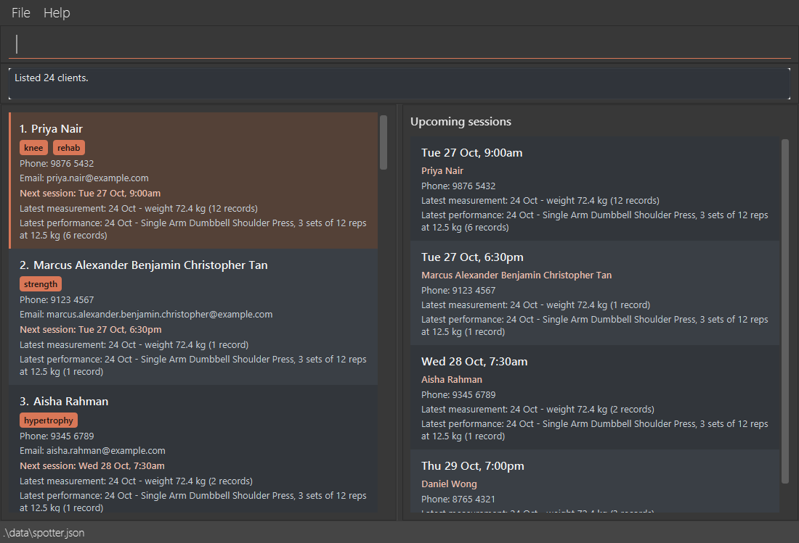
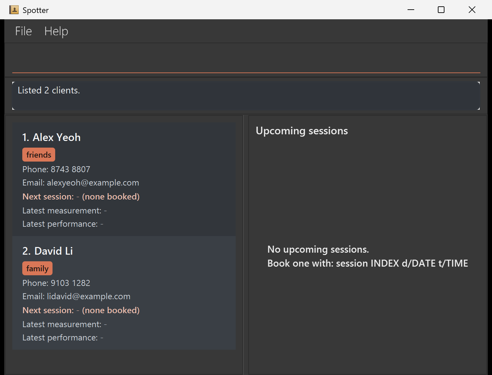
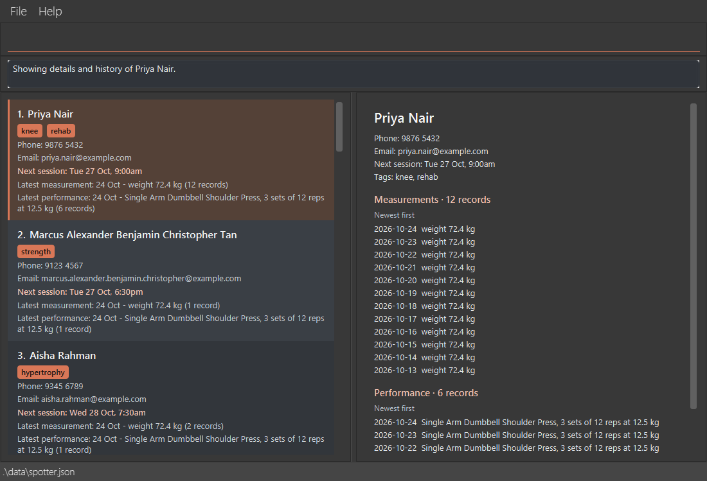

# Spotter User Guide

Spotter is a **desktop application for freelance personal trainers to manage their clients, optimized for use through a Command Line Interface (CLI)** while retaining the benefits of a Graphical User Interface (GUI). If you type quickly, Spotter can help you manage your clients faster than traditional GUI applications.

<!-- * Table of Contents -->
<page-nav-print />

--------------------------------------------------------------------------------------------------------------------

## Quick start

1. Ensure that Java `25` or later is installed on your computer.<br>
   **Mac users:** Ensure you have the precise JDK version prescribed [here](https://se-education.org/guides/tutorials/javaInstallationMac.html).

1. Download the latest `spotter.jar` file from [here](https://github.com/AY2627S1-CS2103T-F14a-2/tp/releases).

1. Copy the file to the folder you want to use as the _home folder_ for Spotter.

1. Open a terminal, `cd` to the folder containing the JAR file, and run `java -jar spotter.jar`.<br>
   A GUI similar to the one below should appear in a few seconds. Note how the app contains some sample client data.<br>
   

   The screenshot includes example bookings and progress records.

1. Type a command in the command box and press Enter to execute it. For example, type **`help`** and press Enter to open the help window.<br>
   Some example commands you can try:

   * `list` : Lists all clients.

   * `add n/John Doe p/98765432 e/johnd@example.com` : Adds a client named `John Doe` to Spotter.

   * `delete 3` : Deletes the 3rd client shown in the current list.

   * `clear` : Deletes all clients.

   * `exit` : Exits the app.

1. Refer to the [Features](#features) section below for details of each command.

--------------------------------------------------------------------------------------------------------------------

## Features

<box type="info" seamless>

**Notes about the command format:**<br>

* Command words are case-insensitive: `LIST` and `List` work like `list`. Prefixes such as `n/` must be in lowercase.

* Words in `UPPER_CASE` are the parameters to be supplied by the user.<br>
  For example, in `add n/NAME`, replace `NAME` with a value such as `John Doe`.

* Items in square brackets are optional.<br>
  For example, `n/NAME [t/TAG]` can be used as `n/John Doe t/friend` or as `n/John Doe`.

* Items followed by `...` can appear zero or more times.<br>
  For example, `[t/TAG]... ` may be omitted, or written as `t/friend` or `t/friend t/family`.

* Parameters can be in any order.<br>
  For example, if the command specifies `n/NAME p/PHONE_NUMBER`, `p/PHONE_NUMBER n/NAME` is also acceptable.

* Extraneous parameters for `help` and `exit` are ignored. `clear` rejects extra parameters.<br>
  For example, `help 123` is interpreted as `help`. `list` does not accept any extra text (see [`list`](#listing-all-clients-list)).

* Tabs pasted into the command box become spaces, preserving separators in commands copied from tabular notes.

* If you are using a PDF version of this document, be careful when copying and pasting commands that span multiple lines as space characters surrounding line-breaks may be omitted when copied over to the application.
</box>

### The Spotter window

The left side lists all your clients. Commands such as `edit`, `delete` and `view` use the index numbers shown there.

The feedback box below the command input stays compact for short messages and expands for longer ones.
Long messages wrap to the available width; scroll inside the feedback box to read any remaining lines.

The right side shows **Upcoming sessions**: one card for each client with a session booked from now on, with the
soonest session at the top. Each card shows the session's date and time, the client's name and phone, and their
latest measurement and performance, so that you can prepare for the session at a glance.

* The cards update as soon as you book, change or cancel a session, or record a measurement or performance.
* Once a session's time has passed, it drops off after your next successful command, and its client card then
  shows `- (none upcoming)` as well.
* The cards have no index numbers. To act on a client, use their index in the client list on the left.
* `find`, `filter` and `sessions` change only the client list; Upcoming sessions still shows every booking.
* With no bookings, it shows `No upcoming sessions.` and how to book one with [`session`](#recording-a-clients-next-session-session).
* [`view INDEX`](#viewing-a-clients-history-view) replaces Upcoming sessions with that client's full history.
  [`list`](#listing-all-clients-list) brings Upcoming sessions back.

### Viewing help: `help`

Shows a message explaining how to access the help page.


Format: `help`

If Help is already open or minimized, `help`, the Help menu and `F1` restore the existing window and bring it forward.


### Adding a client: `add`

Adds a client to Spotter.

Format: `add n/NAME p/PHONE [e/EMAIL] [t/TAG]...`

* `NAME` must start with a Latin-script letter or a digit `0–9`. Supported letters include English `A–Z`/`a–z`
  and accented Latin letters such as `é`; combining accent marks, digits `0–9`, spaces, apostrophes (`'` and `’`),
  hyphens (`-`), full stops (`.`) and slashes (`/`) are also accepted after the first character.
  Names must be 1 to 100 characters after normalization: outer whitespace is removed, repeated whitespace is
  merged, and equivalent accent encodings are stored consistently. Accents are not removed: `José` and `Jose`
  are different names. Non-Latin scripts (for example, Chinese or Tamil letters) and emoji are not supported.
* Names must not contain a space followed by a prefix used by the command, such as ` p/` or ` t/`, because that
  starts another field. For names containing `/`, use the client's index with `session` and `cancelsession`,
  rather than their `n/NAME` forms.
* `PHONE` must contain at least 3 digits and at most 50 characters after normalization. Digits, spaces, letters
  English letters `A–Z`/`a–z` for labels, `+`, `-`, `(`, `)` and `.` are accepted; `/` is not.
  Plain digits and spaces are stored as digits only: `9927 2758` becomes `99272758`. Otherwise, punctuation and
  labels are kept, outer spaces are removed and repeated spaces are merged. For example,
  `1234 5678 (HP) 1111-3333 (Office)` is accepted. Spotter does not check whether a number is dialable.
* `EMAIL` is optional. A client without an email shows `-` in place of it.
  Entering `e/` without an email after it also adds the client without an email, as in `edit`.
* Duplicate clients: a name matching an existing client's, ignoring case and extra spaces, is rejected.
  For example, `john tan` is a duplicate of `John Tan`. A matching phone digit sequence instead gives
  `Warning: <other client's name> also has this phone number.` after the success message; the client is still saved.
  Every matching client is checked, even if hidden by a search or filter, with one warning per match.
* Duplicate detection does not catch typos, nicknames, or a different name order with a different phone.
  Phone comparison ignores formatting and labels but compares **all digits**: numbers with and without a country
  code are different, and a field containing several numbers does not match another field sharing only one.

<box type="tip" seamless>

**Tip:** A client can have any number of tags, including zero.
</box>

Examples:
* `add n/Raju s/o Kumar p/+65 9123 4567`
* `add n/Mary-Jane O'Brien p/1234 5678 (HP) 1111-3333 (Office)`
* `add n/José Tan p/91234567`
* `add n/Sarah Lim p/91234567`
* `add n/John Tan p/88776655 e/john.tan@example.com t/rehab`

### Listing all clients: `list`

Shows a list of all clients in Spotter, clearing any `find` or `filter` results.

Format: `list`

* Type `list` with nothing after it. Extra spaces are fine, but any other text is rejected with:<br>
  `"list" does not take any parameters.`<br>
  `Example: list`
* On success, Spotter shows `Listed N clients.` (or `Listed 1 client.` when you have exactly one client).
* If you have no clients, Spotter shows `You have no clients yet. Use "add" to add your first client.`
* If a client's history is shown with [`view`](#viewing-a-clients-history-view), the right side goes back to
  Upcoming sessions.

<box type="tip" seamless>

**Tip:** Index numbers change when the displayed list changes (e.g., after `find`, `filter`, `add`, or `delete`). Re-run `list` before using an index-based command such as `edit` or `delete`, so that the index refers to the client you expect.
</box>

### Editing a client: `edit`

Edits an existing client in Spotter.

Format: `edit INDEX [n/NAME] [p/PHONE] [e/EMAIL] [t/TAG]... `

* Edits the client at the specified `INDEX`. The index refers to the index number shown in the displayed client list. The index **must be a positive integer** 1, 2, 3, ...
* At least one of the optional fields must be provided.
* Existing values will be updated to the input values.
* When editing tags, all of the client's existing tags are removed; adding tags is not cumulative.
* To remove all of a client's tags, enter `t/` without a tag after it.
* To remove a client's email, enter `e/` without an email after it.
* `NAME` and `PHONE` follow the same rules as in [`add`](#adding-a-client-add), including prefix restrictions.
  For example, `edit 1 p/8743 8807` stores `87438807`, while `edit 1 p/+65 8743 8807 (HP)` keeps its formatting.

* Duplicate clients: the same name rules and shared-phone warnings as in [`add`](#adding-a-client-add) apply.
  The edited client is excluded from phone comparison, so their own number does not cause a warning.
  Changing another field can still warn if a different client shares the phone number.
* Zero, negative or oversized numeric indexes show `The client index provided is invalid.`.
  A missing or nonnumeric index shows `Invalid command format!` followed by the command usage.

Examples:
*  `edit 1 p/91234567 e/johndoe@example.com` Edits the phone number and email address of the 1st client to be `91234567` and `johndoe@example.com` respectively.
*  `edit 2 n/Betsy Crower t/` Edits the name of the 2nd client to be `Betsy Crower` and clears all existing tags.
*  `edit 3 e/` Removes the email of the 3rd client.

### Locating clients by name: `find`

Finds clients whose names contain any of the given keywords.

Format: `find KEYWORD [MORE_KEYWORDS]`

* The search is case-insensitive; for example, `hans` matches `Hans`.
* Keyword order does not matter; for example, `Hans Bo` matches `Bo Hans`.
* The search considers only names.
* Search matches the stored spelling of accented names, so equivalent accent encodings (an `e` plus a combining
  mark versus a precomposed `é`) are not yet matched to one another. This is a planned future enhancement.
* Partial names match anywhere in a name; for example, `han`, `HAN` and `ans` all match `Hans`.
* Clients matching at least one keyword are returned (an `OR` search); for example, `Hans Bo` returns `Hans Gruber` and `Bo Yang`.
* Spotter shows how many clients were found: `Listed N clients.`, `Listed 1 client.`, or `No clients found.` when
  no client matches.

Examples:
* `find han` returns `Hans Gruber` and `Johann Tan`.
* `find John` returns `john` and `John Doe`
* `find alex david` returns `Alex Yeoh`, `David Li`<br>
  

### Filtering clients by tags: `filter`

Shows clients who have at least one of the specified tags.

Format: `filter t/TAG [t/MORE_TAGS]...`

* Supply at least one non-empty tag, with a separate `t/` prefix for each tag.
* Each tag must contain only letters and digits, like the tags that `add` and `edit` accept. Spaces, hyphens and other
  symbols are not allowed, e.g. `t/re-hab` is rejected.
* Matching is case-insensitive and requires the whole tag name: `REHAB` matches `rehab`, but `reh` does not.
* Multiple tags use an `OR` search. `filter t/rehab t/strength` shows clients with either tag or both.
  A tag repeated in a different case, e.g. `t/rehab t/REHAB`, counts once.
* The command searches all clients and replaces any previous `find`, `filter` or `sessions` results.
  Clients without tags do not match. If no clients match, the displayed list is empty.
* Spotter names the tags you searched for, as you typed them: `Listed N clients tagged rehab or knee.`,
  `Listed 1 client tagged rehab.`, or `No clients tagged rehab or knee. Use "list" to show all clients.` when no
  client matches. Three or more tags are listed as `rehab, knee or strength`.
* The client list scrolls back to the top, so the first match is visible.
* Filtering does not change client data. Use the indices in the filtered list for subsequent commands,
  and run `list` to show all clients again.

Examples:
* `filter t/rehab` shows clients with the `rehab` tag.
* `filter t/REHAB t/strength` shows clients with either tag, ignoring case.

| Input problem | Message |
| --- | --- |
| No `t/` prefix, or text before the first prefix, e.g. `filter rehab` | `Invalid command format!`, then `Use: filter t/TAG [t/MORE_TAGS]...` and `Example: filter t/rehab t/strength` |
| An empty tag, e.g. `filter t/` or `filter t/rehab t/` | `Tags to filter by cannot be empty.`, then `Use: filter t/TAG [t/MORE_TAGS]...` |
| A tag that is not alphanumeric, e.g. `filter t/re-hab`, `filter t/best friends`, or extra text after a tag such as `filter t/rehab extra` | `Tags can contain only letters and digits, e.g. t/rehab.`, then `Use: filter t/TAG [t/MORE_TAGS]...` |

<!-- AI assistance: Helen used OpenAI Codex to draft the filter documentation and update UG terminology and the command summary. -->

### Deleting a client: `delete`

Deletes the specified client, and all of their records, from Spotter.

Format: `delete INDEX`

* Deletes the client at the specified `INDEX`.
* The index refers to the index number shown in the displayed client list.
* The index **must be a positive integer** 1, 2, 3, ...

Examples:
* `list` followed by `delete 2` deletes the 2nd client in Spotter.
* `find Betsy` followed by `delete 1` deletes the 1st client in the results of the `find` command.

### Recording body measurements: `measure`

Records a client's weight, body fat percentage or waist measurement.

Only these three measurement types are supported in this version.

Format: `measure INDEX d/DATE t/TYPE v/VALUE`

* `INDEX` is the positive index in the currently displayed client list.
* `DATE` is a real date in `yyyy-MM-dd` format, today or earlier.
* `TYPE` is case-insensitive: `weight` (kg), `bodyfat` (%) or `waist` (cm).
* Weight accepts 1–500 kg; body fat accepts values greater than 0 and up to 100%; waist accepts 1–300 cm.
* Values accept up to two decimal places. Enter only the number, without units, commas or scientific notation.
  Surrounding whitespace is ignored.
* Each prefix must appear exactly once. Prefixes may appear in any order.
* The same date and type replaces the previous value without increasing the record count.
* Records are saved automatically and restored when the application restarts.
* The client card shows the measurement with the latest date and the total record count, for example:
  `Latest measurement: 12 Sep - weight 72.4 kg (4 records)`. A date outside the current year includes the year,
  e.g. `12 Sep 2025`.
* When multiple types share the latest date, the card prefers weight, then body fat, then waist.
* Clients without measurements show `Latest measurement: -`.
* The count includes all dates and types. Adding an older measurement increases the count but does not change
  the displayed latest measurement. A single record is shown as `(1 record)`.

Examples:

Run `list` first and use the displayed index of your intended client. These examples use client 1.

* `measure 1 d/2026-09-12 t/weight v/72.4` records a weight measurement.
* `measure 1 d/2026-09-12 t/weight v/71.8` updates that record.
* `measure 1 d/2026-09-12 t/waist v/81` adds a separate waist record.
* `measure 1 d/2026-09-12 t/bodyfat v/18.4` adds a separate body fat record.

Success messages begin with `Recorded measurement for` or `Updated measurement for`,
followed by the client's name, measurement and date. Invalid input is rejected without changing records.

For a client named Alex Tan, the first two examples produce:

```text
Recorded measurement for Alex Tan: weight = 72.4 kg on 2026-09-12.
Updated measurement for Alex Tan: weight = 71.8 kg on 2026-09-12.
```

<!-- AI assistance: Helen used OpenAI Codex to clarify measurement index errors for issue #166. -->
<!-- AI assistance: Helen used OpenAI Codex to align date-error examples for issue #164. -->

Common errors:

| Input problem | Message |
| --- | --- |
| Missing or repeated prefix, missing or malformed index (e.g. `one`, `+1`, `1.5`) | `Invalid command format. Use: measure INDEX d/DATE t/TYPE v/VALUE` |
| Zero, negative, overflowing or out-of-range index | `The client index provided is invalid.` |
| Date not in `yyyy-MM-dd` format, or year, month or day out of range, e.g. `2026-13-01` | `Date must use YYYY-MM-DD format (year 0001-9999, month 01-12, day 01-31).` |
| Date in the right format that does not exist, e.g. `2026-02-30` | `2026-02-30 is not a real date.` |
| Future date | `The measurement date cannot be in the future.` |
| Unsupported type | `Measurement type must be weight, bodyfat, or waist.` |
| Non-numeric value | `Measurement value must be numeric.` |
| Too many decimal places | `Measurement values may have at most two decimal places.` |

Out-of-range values produce a message stating the permitted range for that type.
Parsing errors and invalid client indexes also show the expected command format.

If saving fails, Spotter displays `Unable to save Spotter data` and restores the previous client records
and displayed list. The failed measurement is not retained in memory.

<!-- AI assistance: OpenAI Codex helped draft the measurement command documentation. -->

### Deleting a body measurement: `deletemeasure`

Removes one measurement recorded for the wrong date or type.

Format: `deletemeasure INDEX d/DATE t/TYPE`

* `INDEX` is the positive index in the currently displayed client list, including filtered results.
* `DATE` must be a real date in `yyyy-MM-dd` format, with a year from 0001 to 9999.
  Future dates are accepted so that records loaded from a manually edited data file can still be removed.
* `TYPE` is case-insensitive: `weight`, `bodyfat` or `waist`. No measurement value is needed.
* Each prefix must appear exactly once; prefixes may appear in any order. Surrounding whitespace is ignored.
* Only the measurement matching both date and type is deleted. Other measurements, contact details, tags,
  the next session and gym-performance records are kept. The active client filter is kept.
* The client card immediately shows the remaining record count and latest measurement, using the same
  same-date type order as `measure`. Deleting the final measurement shows `Latest measurement: -`.
* Deletions are saved automatically and remain deleted after restarting Spotter.

Example: run `list`, identify your intended client's index, and use that index in place of `1` below.

1. `measure 1 d/2026-09-12 t/weight v/72.4` records a weight measurement.
2. `deletemeasure 1 d/2026-09-12 t/weight` deletes that measurement.

For a client named Alex Tan, the deletion produces:

```text
Deleted measurement for Alex Tan: weight = 72.4 kg on 2026-09-12.
```

Repeating the deletion produces `No measurement record for weight on 2026-09-12 was found for Alex Tan.`
and leaves the data unchanged.

| Input problem | Message |
| --- | --- |
| Missing or repeated prefix, missing or non-numeric index | `Invalid command format. Use: deletemeasure INDEX d/DATE t/TYPE` |
| Zero, negative, overflowing or out-of-range index | `The client index provided is invalid.` |
| Date not in `yyyy-MM-dd` format, or year, month or day out of range, e.g. `2026-13-01` | `Date must use YYYY-MM-DD format (year 0001-9999, month 01-12, day 01-31).` |
| Date in the right format that does not exist, e.g. `2026-02-30` | `2026-02-30 is not a real date.` |
| Unsupported or empty type | `Measurement type must be weight, bodyfat, or waist.` |

Validation errors include the expected command format. A missing-record error does not include usage.
Errors leave data unchanged. If saving fails, Spotter shows `Unable to save Spotter data.` and restores
the previous records and displayed list.

### Recording a gym performance: `performance`

Records a client's result for one exercise on a given date, so that you can track their training progress.

Format: `performance INDEX d/DATE e/EXERCISE s/SETS r/REPS w/LOAD`

* Records the performance for the client at the specified `INDEX`, as shown in the displayed client list.
* Each prefix must appear exactly once. The prefixes can be in any order.
* If the client already has a record for the same exercise on the same date, the new sets, repetitions and load
  replace the old record. Spotter keeps one result per exercise per client per day, so you can correct a mistake
  by recording it again.

Parameter | Accepted values
----------|----------------
`INDEX` | A positive integer from the displayed client list, e.g. `1`.
`DATE` | A real date in `yyyy-MM-dd` format, e.g. `2026-09-18`. It can be today or in the past, but not in the future.
`EXERCISE` | 1 to 50 characters: English letters (A–Z), digits (0–9), spaces, hyphens (`-`), apostrophes (`'` or `’`), parentheses (`(` and `)`), ampersands (`&`), plus signs (`+`) and full stops (`.`), for example `Row (Cable)`, `Clean & Jerk` or `1.5 Rep Squat`. Slashes (`/`) are not accepted, because Spotter would read text such as ` w/` as another prefix. Accented and non-English letters, such as `é`, are not accepted. Parentheses do not need to be paired. It must contain at least one letter or digit. Extra spaces are ignored, and letter case and the apostrophe style do not matter when checking for an existing record, so `bench press` and `Bench Press` are the same exercise, and so are `Farmer's Walk` and `Farmer’s Walk`. The same rules apply when deleting a record or loading stored exercise names.
`SETS` | A whole number from 1 to 100.
`REPS` | The repetitions per set, as a whole number from 1 to 1000.
`LOAD` | The load in kg, from 0 to 1000, with at most two decimal places. Use `0` for bodyweight exercises. Do not type the unit.

After a performance is recorded, the client's card shows their latest performance and the number of records,
e.g. `Latest performance: 18 Sep - Bench Press, 3 sets of 8 reps at 60 kg (4 records)`.
If several records share the latest date, the one recorded last is shown. A date outside the current year includes
the year, e.g. `18 Sep 2025`.

Examples:
* `performance 2 d/2026-09-18 e/Bench Press s/3 r/8 w/60` records `Recorded performance for <client name>: Bench Press, 3 sets of 8 reps at 60 kg on 2026-09-18.`
* `performance 2 d/2026-09-18 e/Pull-up s/3 r/10 w/0` records a bodyweight exercise.
* `performance 2 d/2026-09-18 e/bench press s/3 r/8 w/62.5` then replaces the first record and shows `Updated performance for <client name>: bench press, 3 sets of 8 reps at 62.5 kg on 2026-09-18.`

If the command is not accepted, Spotter shows the reason followed by the expected format, and no record is added or changed:

Problem | Message
--------|--------
A prefix is missing or repeated, or `INDEX` is missing or not a number | `Invalid command format. Use: performance INDEX d/DATE e/EXERCISE s/SETS r/REPS w/LOAD`
`INDEX` is 0, negative, or larger than the displayed list | `The client index provided is invalid.`
`DATE` is not in `yyyy-MM-dd` format, or its year, month or day is out of range, e.g. `2026-13-01` | `Date must use YYYY-MM-DD format (year 0001-9999, month 01-12, day 01-31).`
`DATE` is in the right format but does not exist, e.g. `2026-02-30` | `2026-02-30 is not a real date.`
`DATE` is in the future | `The performance date cannot be in the future.`
`EXERCISE` is invalid | `Exercise names must be 1 to 50 characters and may contain only English letters (A-Z), digits (0-9), spaces, hyphens, apostrophes, parentheses, and the symbols & + .`
`SETS` is invalid | `The number of sets must be a whole number between 1 and 100.`
`REPS` is invalid | `The number of repetitions must be a whole number between 1 and 1000.`
`LOAD` is not a number | `Exercise load must be numeric.`
`LOAD` is outside 0 to 1000 | `Exercise load must be between 0 and 1000 kg.`
`LOAD` has more than two decimal places | `Exercise load may have at most two decimal places.`

### Deleting a gym performance: `deleteperformance`

Deletes one of a client's gym-performance records, for example a record entered by mistake.

Format: `deleteperformance INDEX d/DATE e/EXERCISE`

* Deletes the record for `EXERCISE` on `DATE` for the client at the specified `INDEX`, as shown in the displayed
  client list.
* Each prefix must appear exactly once. The prefixes can be in any order.
* `EXERCISE` is matched ignoring letter case, extra spaces and the apostrophe style, so `bench press` matches a record for `Bench Press`, and `Farmer's Walk` matches `Farmer’s Walk`.
* `DATE` uses the `yyyy-MM-dd` format. Unlike `performance`, a future date is accepted, so that a future-dated
  record in an edited data file can still be deleted.
* The client's other records, next session and body measurements are not changed.
* The client's card is updated straight away: the latest performance and the record count are recalculated from
  the remaining records. If no records remain, the card shows `Latest performance: -`.

Examples:
* `deleteperformance 2 d/2026-09-18 e/Bench Press` deletes the bench press record of 18 Sep 2026 and shows
  `Deleted performance for <client name>: Bench Press, 3 sets of 8 reps at 60 kg on 2026-09-18.`
* `deleteperformance 1 d/2026-09-15 e/squat` deletes the squat record of 15 Sep 2026.

To change a record instead of deleting it, use `performance` with the same date and exercise to replace it.

If the command is not accepted, Spotter shows the reason and no record is deleted. Except when no matching record
is found, the reason is followed by the expected format:

Problem | Message
--------|--------
A prefix is missing or repeated, or `INDEX` is missing or not a number | `Invalid command format. Use: deleteperformance INDEX d/DATE e/EXERCISE`
`INDEX` is 0, negative, or larger than the displayed list | `The client index provided is invalid.`
`DATE` is not in `yyyy-MM-dd` format, or its year, month or day is out of range, e.g. `2026-13-01` | `Date must use YYYY-MM-DD format (year 0001-9999, month 01-12, day 01-31).`
`DATE` is in the right format but does not exist, e.g. `2026-02-30` | `2026-02-30 is not a real date.`
`EXERCISE` is invalid | `Exercise names must be 1 to 50 characters and may contain only English letters (A-Z), digits (0-9), spaces, hyphens, apostrophes, parentheses, and the symbols & + .`
The client has no record for that exercise on that date | `No performance record for <exercise> on <date> was found for <client name>.`

### Viewing a client's history: `view`

Shows one client's details together with all of their measurements and gym performances, so that you can review
their progress before a session.

Format: `view INDEX`

* Shows the client at the specified `INDEX`, as shown in the displayed client list.
* The index **must be a positive integer** 1, 2, 3, ...
* The details replace Upcoming sessions on the right side of the window, and the result box shows
  `Showing details and history of <client name>.` The client list and cards do not change, and no data is changed.
* The history stays up to date: after you edit the client, or add, delete or replace their records or session,
  it shows the change straight away. You do not need to run `view` again, so you can keep it open while you
  record a session.
* The history stays even if a later `find`, `filter` or `sessions` hides the client from the list.
* Upcoming sessions comes back when you enter `list`, delete that client, or clear all data.
* Measurements and performance have separate headings with record counts. Each section lists records with the
  newest date first, so the most recent ones are always at the top.
  * Measurements on the same date are listed in the order weight, body fat, waist.
  * Performances on the same date are listed with the one recorded last first, so the first performance line
    always matches the card's `Latest performance`.
* `Next session` shows the same text as the client's card.
* Tags are listed alphabetically. A client with no email or no tags shows `-`.

Examples:
* `list` followed by `view 2` shows the history of the 2nd client in Spotter.
* `find Alex` followed by `view 1` shows the history of the 1st client in the results of the `find` command.

For a client named Alex Tan with three measurements and two performances, `view 1` shows this in the panel,
with the name as its title:

```text
Alex Tan
Phone: 9123 4567
Email: alex@example.com
Next session: Fri 23 Oct, 6:00pm
Tags: knee, rehab

Measurements · 3 records
Newest first
2026-10-12  weight 72.4 kg
2026-10-12  waist 81 cm
2026-09-30  weight 73 kg

Performance · 2 records
Newest first
2026-10-15  Squat, 3 sets of 5 reps at 100 kg
2026-10-01  Bench Press, 3 sets of 8 reps at 60 kg
```

A client with no records of a kind shows `None recorded yet.` under that section's heading, which shows `0 records`.
A section with one record shows `1 record`.

The history sections appear like this (with fictional example records):



Problem | Message
--------|--------
`INDEX` is missing or not a whole number, or there is extra text after it | `Invalid command format!` followed by the expected format
`INDEX` is 0, negative, or larger than the displayed list | `The client index provided is invalid.`

If a command fails, the panel keeps showing the client as they were before that command.

<!-- AI assistance: Claude Code helped draft the view command documentation. -->

### Clearing all entries: `clear`

Clears all clients from Spotter.

Format: `clear`

`clear` takes no parameters. Inputs such as `clear 1` or `clear all` are rejected without changing clients,
their records, the current view or the saved data. To remove one client, use `delete INDEX`.

### Exiting the program: `exit`

Exits the program.

Format: `exit`

### Recording a client's next session: `session`

Records one next session for an existing client. A new booking replaces that client's previous booking.

**`session` records or replaces a booking; `sessions` (with a final `s`) only lists bookings on a date.**
Use `session INDEX d/DATE t/TIME` to book and `sessions d/DATE` to inspect the schedule.

Format: `session INDEX d/DATE t/TIME` or `session n/NAME d/DATE t/TIME`

* `INDEX` is the positive number shown on the **current displayed list**, including a filtered list.
* `NAME` must match a client's full name. Matching ignores case, leading/trailing whitespace, and repeated
  internal spaces, including equivalent accent encodings. Names cannot be empty.
  The `n/NAME` form does not support `/`, even though `add` and `edit` allow it: use the displayed client index
  for names such as `Raju s/o Kumar`.
* `DATE` must be a real date in `YYYY-MM-DD` format, such as `2026-12-15`. A past date or time is accepted, so you
  can record a session late; the message then adds `Note: this session is in the past, so it shows as "- (none upcoming)".`
* `TIME` is a 24-hour time with an optional colon and a one- or two-digit hour, such as `930`, `0930`, `9:30` or
  `19:00`. Midnight is `0000`; `2400` is invalid.
* Supply exactly one identifier and one of each required prefix. Unknown or repeated prefixes are rejected.

Examples:

* `session 1 d/2026-12-15 t/1900`
* `session n/Sarah Lim d/2026-12-15 t/19:00`
* `session n/sarah lim d/2026-12-15 t/1900`

Success: `Recorded next session for Sarah Lim on 2026-12-15 at 19:00`.
The stored client's name is used in the message; both time formats are stored and reported as `HH:mm`.
Replacing a different booking reports `Rescheduled next session for Sarah Lim from 2026-12-15 19:00 to 2026-12-16 09:00.`
Entering the same booking again reports `Next session for Sarah Lim is already recorded on 2026-12-15 19:00.`
If another client is booked at exactly that date and time, Spotter appends
`Warning: This time is also booked for Alex Tan. All bookings are kept.`
All matching clients are named alphabetically, including clients outside the current filter.
This is a warning: the booking still succeeds. Spotter does not store session durations, so different start times
are not checked for overlapping durations.
The booking is saved automatically and survives restarting Spotter. Editing contact details preserves it,
and deleting the client removes it together with the client.

After a successful booking, all clients are shown and the list scrolls to the top. Upcoming sessions appear first, soonest first, with
case-insensitive alphabetical names breaking ties. Expired recorded sessions follow upcoming ones, followed
by clients with no recorded session; unbooked clients are alphabetical. This order also applies to `list`,
filtered lists, and startup. Sorting the displayed list does not reorder the JSON file.
After each successful command, the order and session card rows are refreshed to account for bookings that have passed.
An index-based command acts on the client shown at that index before this refresh.
**Index numbers can change after a booking or a client change. Check the displayed list before any index-based command.**

The card shows `Next session: Tue 15 Dec, 7:00pm` for an upcoming booking (with the year for a booking in another
year, e.g. `Wed 15 Dec 2027, 7:00pm`), `Next session: - (none booked)`
when no session has been recorded, and `Next session: - (none upcoming)` when the recorded booking has passed.
Expired bookings are retained in the data file until replaced or cancelled.

Invalid commands leave client data and list order unchanged. The relevant messages are:

Error | Message
------|--------
Missing/repeated/unknown prefix or both identifiers | `Invalid command format! Use: session INDEX d/DATE t/TIME or session n/NAME d/DATE t/TIME`
Invalid index | `The client index provided is invalid.`
Unknown name | `No client with that name exists in Spotter.`
Empty name | `Name cannot be empty.`
Name containing a slash | `Name must not contain '/'.`, or the format error above if part of the name is parsed as an unknown prefix (e.g. `s/` in `Raju s/o Kumar`); use the client index instead.
Malformed date or component out of range | `Date must use YYYY-MM-DD format (year 0001-9999, month 01-12, day 01-31).`
Impossible calendar date (e.g. `2026-02-30`) | `2026-02-30 is not a real date.`
Invalid time | `Time must be a 24-hour time such as 930, 0930, 9:30 or 19:00.`

### Cancelling a recorded session: `cancelsession`

Removes the recorded session for the client at the current displayed index or with the specified full name.

Format: `cancelsession INDEX` or `cancelsession n/NAME`

* `INDEX` must be a positive integer shown in the current list, including results from `find`, `filter` or `sessions`.
* `NAME` follows the same full-name matching rules as `session n/NAME`: case and extra spaces are ignored.
  It searches all clients, even if the client is hidden by the current filter. Supply exactly one identifier.
  For a name containing `/`, use `cancelsession INDEX` instead.
* Both upcoming and expired recorded sessions can be cancelled.
* Contact details, tags, measurements and performance records are preserved. The cancellation is saved automatically.
* The current filter stays active. A cancelled client disappears from a `sessions` date view, but remains in Spotter.
  In the full list, their card shows `Next session: - (none booked)` and moves to the unbooked group.
* Indices may change after cancellation. Check the displayed list before entering the next index-based command.
  If the cancelled client disappears from the displayed list, the message adds
  `NAME is no longer shown here; clients below have moved up one place.`
* A client with no recorded session is rejected with `No session is recorded for NAME.`
  An invalid index shows `The client index provided is invalid.`
  Missing, non-numeric or mixed identifiers show
  `Invalid command format! Use: cancelsession INDEX or cancelsession n/NAME`.
  Unknown names show `No client with that name exists in Spotter.`; empty names and slashes use the booking errors above.
* If saving fails, the original session and displayed list are restored and `Unable to save Spotter data.` is shown.

<box type="tip" seamless>

**Tip:** In a `sessions` date view, prefer `cancelsession n/NAME` for names without `/`.
For slash-containing names, use the displayed index and check the list again after each cancellation.
</box>

Example: `cancelsession 1` cancels the first displayed client's session.
Alternatively, `cancelsession n/Sarah Lim` cancels Sarah's booking without relying on a changing list index.
Success: `Cancelled session on 2026-12-15 09:00 for Sarah Lim.` (when that is her recorded booking).
The confirmation includes the removed booking's date and 24-hour time, including for expired bookings.
In a `sessions` date view, it continues: `Sarah Lim is no longer shown here; clients below have moved up one place.`

### Listing sessions on a date: `sessions`

Shows clients whose recorded session is on a specified date. This searches all clients and replaces the previous filter.

Format: `sessions d/DATE`

* `DATE` must be a real `YYYY-MM-DD` date, with a year from `0001` to `9999`. Past dates are accepted for retained bookings.
* Supply exactly one `d/` prefix. Missing/repeated/unknown prefixes or extra arguments show
  `Invalid command format! Use: sessions d/DATE`. Invalid dates use the date-format/calendar errors listed under `session`.
* Results use the normal session ordering: upcoming bookings first, then expired bookings, with time and name breaking ties.
  For today, this puts upcoming sessions before sessions whose times have passed.
* Spotter still stores only one session per client. Replaced or cancelled bookings cannot be retrieved using this command.
  An expired booking's card continues to show `- (none upcoming)`.
* The panel scrolls to the top and displayed indices start at 1. The command changes no client data and does not save the file.
* Use `list` to show all clients again. Use the indices in the current results for `cancelsession`, `edit` or `delete`.

<box type="tip" seamless>

**Tip:** In a `sessions` date view, prefer `cancelsession n/NAME` for names without `/`.
For slash-containing names, use the displayed index and check the list again after each cancellation.
</box>

Example: `sessions d/2026-12-15`.

Result | Message
-------|--------
Multiple matches | `Listed 3 clients with sessions on 2026-12-15.`
One match | `Listed 1 client with a session on 2026-12-15.`
No matches (empty panel) | `No sessions recorded on 2026-12-15.`

### Saving the data

Spotter saves your data automatically to `[JAR file location]/data/spotter.json` after each command that changes it. You do not need to save manually.

The folder containing `spotter.jar` is Spotter's home folder. The same folder holds `preferences.json`
(window settings) and the rotating `spotter.log.*` files. Launching the JAR from a terminal in another folder
still uses these files beside the JAR. The save-location footer shows the absolute data-file path.

* If saving fails (e.g., the data file or folder is read-only), the change is undone and Spotter shows `Unable to save Spotter data.`
* If the data file is missing, Spotter starts with sample data.
* If the data file is damaged, Spotter starts with no clients and shows `Unable to load saved Spotter data. The existing data file has not been modified.` The damaged file is left untouched until your next successful command that changes data, which overwrites it.

When moving Spotter, close it and move the JAR together with its `data` folder. Copy `preferences.json` too
if you want to retain window settings. If an older build saved your clients in a different terminal folder,
back up that data file and copy it to `[JAR file location]/data/spotter.json` while Spotter is closed.
Back up any existing destination file before replacing it. Spotter does not search other folders for old data.

### Editing the data file

Spotter data is saved automatically as a JSON file `[JAR file location]/data/spotter.json`. Advanced users are welcome to update data directly by editing that data file. Save it as UTF-8, with or without a byte-order mark (BOM).

<box type="warning" seamless>

**Caution:**
If your changes make the data file invalid, Spotter starts with no clients at the next run and shows a warning. The invalid file remains on disk until your next successful command that changes data, which overwrites it. Therefore, we recommend backing up the file before editing it.<br>
Furthermore, certain edits can cause Spotter to behave in unexpected ways (e.g., if a value entered is outside of the acceptable range). Therefore, edit the data file only if you are confident that you can update it correctly.
</box>

### Archiving data files `[coming in v2.0]`

_Details coming soon ..._

--------------------------------------------------------------------------------------------------------------------

## FAQ

**Q**: How do I transfer my data to another computer?<br>
**A**: Install the app on the other computer and overwrite the data file it creates with the data file from your previous Spotter home folder.

**Q**: How do I back up my clients' data?<br>
**A**: Close Spotter and copy `[JAR file location]/data/spotter.json` to a safe place. To restore it, close Spotter and copy the backup back to the same location. See [Saving the data](#saving-the-data).

**Q**: Spotter started with no clients after I edited the data file. Is my data lost?<br>
**A**: Not yet. Spotter could not read the edited file, so it left the file unchanged. Close Spotter **before** running any command that changes data, as that would overwrite the file. Then fix your edit or restore your backup. See [Editing the data file](#editing-the-data-file).

**Q**: I recorded a gym performance with the wrong numbers. How do I fix it?<br>
**A**: Record it again for the same client, date and exercise. The new sets, repetitions and load replace the old record, and Spotter shows `Updated performance for ...`. To remove the record instead, use [`deleteperformance`](#deleting-a-gym-performance-deleteperformance).

**Q**: Why are `bench press` and `Bench Press` the same exercise, but `Clean & Jerk` and `Clean and Jerk` are not?<br>
**A**: Spotter ignores letter case, extra spaces and the apostrophe style, but otherwise compares exercise names as typed. Use the same wording each time so that a client's records for one exercise stay together.

**Q**: Why can't I record a measurement or performance for a future date?<br>
**A**: Measurements and performances record results a client has already achieved, so `measure` and `performance` accept only today or past dates. To plan a future session, use [`session`](#recording-a-client-s-next-session-session).

**Q**: The Upcoming sessions panel has been replaced by one client's history. How do I get it back?<br>
**A**: Use [`list`](#listing-all-clients-list). [`view INDEX`](#viewing-a-client-s-history-view) is what shows a client's history in place of Upcoming sessions.

--------------------------------------------------------------------------------------------------------------------

## Current contact-input limitations

Client names are labels for the trainer's own records; Spotter does not verify legal names or require a legal-name
match. The current Latin-script and punctuation support is a bounded design choice, not support for every language.
A supported preferred spelling can be used if suitable for the trainer and client; otherwise that name cannot yet
be recorded in its original script. Broader language support is a planned enhancement, not a current feature.

Names containing command prefixes preceded by a space cannot be entered literally through those commands.
Slash-containing names are accepted by `add` and `edit`, but session booking/cancellation must use the displayed
client index. Phone labels support English letters only, and accepted numbers are not checked for dialability.

--------------------------------------------------------------------------------------------------------------------

## Restoring the window

Spotter remembers the main window's size and position. At startup, a partly off-screen window is moved
and, if needed, resized to fit within one available screen's usable area. Valid positions on secondary
screens are preserved. If the saved window is completely off-screen or its dimensions are invalid,
Spotter restores the default size, reduced if necessary to fit, centered on the primary screen.
You do not need to delete `preferences.json` after disconnecting a monitor.

--------------------------------------------------------------------------------------------------------------------


## Known issues

1. **If you minimize the Help Window** and then run the `help` command (or use the `Help` menu, or the keyboard shortcut `F1`) again, the original Help Window will remain minimized, and no new Help Window will appear. The remedy is to manually restore the minimized Help Window.
2. **Unrecognized prefixes are not reported**: text such as `a/x` that uses a prefix Spotter doesn't support is treated as part of the field before it. For example, `add n/John Tan p/91234567 a/x` reports an invalid phone number. The remedy is to remove the unsupported prefix.
3. **Warnings when launching from a terminal**: on some Java setups, such as JDKs that bundle JavaFX (e.g. Zulu FX), `java -jar spotter.jar` prints `WARNING` lines about a restricted method and enabling native access. These come from JavaFX loading its native libraries. They are harmless, and Spotter works normally.

--------------------------------------------------------------------------------------------------------------------

## Command summary

Action     | Format, Examples
-----------|----------------------------------------------------------------------------------------------------------------------------------------------------------------------
**Add**    | `add n/NAME p/PHONE [e/EMAIL] [t/TAG]...` <br> e.g., `add n/James Ho p/22224444 e/jamesho@example.com t/rehab`
**Clear**  | `clear`
**Exit**   | `exit`
**Delete** | `delete INDEX`<br> e.g., `delete 3`
**Edit**   | `edit INDEX [n/NAME] [p/PHONE] [e/EMAIL] [t/TAG]... `<br> e.g.,`edit 2 n/James Lee e/jameslee@example.com`
**Find**   | `find KEYWORD [MORE_KEYWORDS]`<br> e.g., `find James Jake`
**Filter** | `filter t/TAG [t/MORE_TAGS]...`<br> e.g., `filter t/rehab t/strength`
**List**   | `list`
**Session** | `session INDEX d/DATE t/TIME` or `session n/NAME d/DATE t/TIME`<br> e.g., `session 1 d/2026-12-15 t/1900`
**Cancel session** | `cancelsession INDEX` or `cancelsession n/NAME`<br> e.g., `cancelsession 1`, `cancelsession n/Sarah Lim`
**Sessions on date** | `sessions d/DATE`<br> e.g., `sessions d/2026-12-15`
**Measure** | `measure INDEX d/DATE t/TYPE v/VALUE`<br> e.g., `measure 1 d/2026-09-12 t/weight v/72.4`
**Performance** | `performance INDEX d/DATE e/EXERCISE s/SETS r/REPS w/LOAD`<br> e.g., `performance 2 d/2026-09-18 e/Bench Press s/3 r/8 w/60`
**Delete measurement** | `deletemeasure INDEX d/DATE t/TYPE`<br> e.g., `deletemeasure 1 d/2026-09-12 t/weight`
**Delete performance** | `deleteperformance INDEX d/DATE e/EXERCISE`<br> e.g., `deleteperformance 2 d/2026-09-18 e/Bench Press`
**View** | `view INDEX`<br> e.g., `view 1`
**Help**   | `help`
